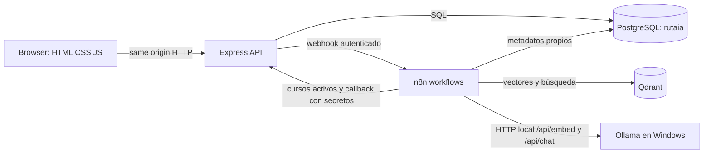

# Manual de continuidad de RutaIA

**Actualizado:** 3 de noviembre de 2026
**Propósito:** permitir que otra sesión retome el proyecto sin inferir estado, inventar cursos ni exponer secretos.

## 1. Qué es y qué está funcionando

RutaIA orienta a estudiantes a partir de un catálogo institucional. El navegador usa la API Express; PostgreSQL conserva cuentas, cursos, consultas y calificaciones; n8n coordina la indexación y generación RAG; Qdrant recupera candidatos vectoriales; Ollama local ejecuta embeddings y generación. El profesor autorizó esta excepción al enunciado, que originalmente pedía Java/Spring Boot y proveedor de modelos remoto: RutaIA conserva Node.js/Express y procesamiento local, con costo de inferencia cero.

**Autoría:** desarrollo individual del estudiante propietario del proyecto. No atribuir tareas, decisiones ni contribuciones a integrantes inexistentes. El enunciado conserva sus requisitos, aunque describa equipos.

**Datos reales:** las operaciones del producto deben leer y persistir datos en PostgreSQL y, en RAG, recuperar cursos/scores reales de Qdrant. Los datos sintéticos mencionados en la matriz son fixtures temporales de pruebas de integración con la base dedicada; no deben incorporarse al catálogo institucional ni citarse como recomendación real. Las respuestas generativas se permiten únicamente bajo el flujo RAG fundamentado en fuentes existentes.

Estado comprobado en este entorno:

- 3 nov: `docker compose --env-file .env config --quiet` y `docker compose up --build -d` pasaron; los cuatro servicios RutaIA quedaron `healthy`. `/health/ready`, n8n `/healthz` y Qdrant `/readyz` respondieron HTTP 200.
- 3 nov: backend actualizado reconstruido y saludable. Ollama local tiene `bge-m3` y `qwen2.5:3b`; el contenedor n8n obtuvo HTTP 200 desde `host.docker.internal:11434/api/tags`.
- 3 nov: los dos workflows actuales están guardados por sus IDs existentes (14 nodos cada uno), sin duplicados y permanecen inactivos. El workflow real de indexación n8n se ejecutó dos veces con éxito usando el catálogo público: 20 embeddings BGE-M3 de 1024 dimensiones, upsert/reconciliación Qdrant; después de repetir seguían exactamente 20 puntos. Una búsqueda real Ollama→Qdrant devolvió cinco cursos de Gastronomía sobre el umbral 0.50.
- `/health/ready` devolvió `ready`. Sondas desde contenedores recibieron HTTP 200 backend→n8n, backend→Qdrant, n8n→backend y n8n→Qdrant.
- 3 nov: inspección de solo lectura del esquema PostgreSQL confirmó ocho tablas, 8 claves primarias, 7 foráneas, 17 `CHECK`, 4 `UNIQUE` y 21 índices. Tras la curación oficial, la base contiene 20 ofertas INTECAP; Qdrant tiene la colección Cosine `rutaia_courses`, 1024 dimensiones y 20 puntos.
- La migración `002_finite_similarity_score.sql` quedó aplicada en `rutaia` y `rutaia_test`; reemplaza el constraint de score para rechazar `NaN` y ambas infinitudes. La integración probó los tres rechazos y la migración repetida fue idempotente.
- La inspección visual autenticada sigue pendiente. En esta sesión Work settings deshabilitó el navegador local; no se crearon cuentas ni se enviaron formularios.
- 3 nov: `npm test`: 24 aprobadas, 0 fallidas y 1 integración optativa omitida. Incluye seis pruebas aisladas de Code nodes (catálogo vacío, selección de fuentes y estructura JSON de Ollama) y pruebas del cliente n8n. `npm run test:integration`: 1 aprobada contra `rutaia_test`, comprobó autenticación, catálogo, historial/aislamiento, callbacks, calificaciones e idempotencia.
- `npm run validate:openapi`: 25 paths, 28 operaciones coincidentes con routers/montajes de `app.js`, 95 referencias locales resueltas y schemas obligatorios para éxitos 200/201/202 y errores HTTP declarados.
- El frontend sirve las vistas de auth, inicio/consulta, catálogo, historial, perfil y administración. La carga de categorías recorre páginas; la UI solo declara logout exitoso tras respuesta del servidor.
- **RAG integral aún no está habilitado:** el workflow de indexación real se ejecutó dos veces; `rutaia_courses` conserva 20 puntos y la búsqueda local devuelve resultados del tema. Los dos workflows siguen inactivos. La calibración sintética produjo rango candidato `0.4475–0.5785`; `.env` usa `RAG_MIN_SIMILARITY=0.50`. Las tres credenciales ya existen; sync está asignada en los dos nodos de indexación. Falta asignar bearer al webhook, sync al nodo de catálogo de consulta, callback a los tres nodos de resultado y cambiar a `None` la autenticación OpenRouter de los nodos Ollama; después, ejecutar consulta→callback→historial/calificación.

`healthy` demuestra disponibilidad de proceso/healthcheck, no significa que el RAG esté listo.

## 2. Arquitectura y conexiones



En Compose, los nombres DNS internos son `backend`, `postgres`, `qdrant` y `n8n`. El browser usa los puertos publicados en loopback: aplicación `APP_PORT` (3001 en esta PC; 3000 por defecto), PostgreSQL 5432, Qdrant 6333 y n8n 5678. No se deben publicar esos puertos directamente a Internet.

El backend sirve `frontend/` estáticamente y aplica las migraciones al iniciar. Cookie de sesión HttpOnly más `X-CSRF-Token` protegen las mutaciones. El browser no llama Qdrant, n8n ni Ollama directamente. n8n usa `host.docker.internal:11434` para alcanzar Ollama en Windows; verifica que el endpoint sea accesible desde el contenedor antes de activar workflows.

## 3. Mapa del repositorio

- `frontend/index.html`, `frontend/assets/css/styles.css`, `frontend/assets/js/app.js`: experiencia de login/registro, consulta, recomendaciones, catálogo, perfil, historial y vistas admin.
- `backend/src/app.js`: middleware, CORS, security headers, mounts de routers y estáticos.
- `backend/src/routes/`: endpoints de auth, cursos, estudiantes, consultas, recomendaciones y salud.
- `backend/src/controllers/`, `services/`, `repositories/`, `validators/`: HTTP, dominio, SQL y esquemas Zod.
- `backend/src/integrations/n8n/`: invocación de webhook desde Express.
- `backend/scripts/`: migración, promoción admin, runner de integración y validador OpenAPI.
- `database/migrations/001_initial_schema.sql`, `002_finite_similarity_score.sql` y `003_intecap_career_type.sql`: esquema, restricción finita para scores y clasificación INTECAP nullable separada del nivel RutaIA, aplicados por el migrador versionado.
- `database/docker-init/001-n8n-schema.sql`: preparación del esquema PostgreSQL de n8n.
- `automation/n8n/index-courses.json`: indexación/reconciliación de cursos activos.
- `automation/n8n/answer-query.json`: consulta, recuperación, selección de fuentes, generación y callback.
- `docs/api/openapi.yaml`: contrato de API.
- `docs/architecture/`, `docs/testing/`: modelo, contexto, diagnóstico y evidencia.

Entidades relacionales principales: estudiantes y sesiones; cursos; consultas; recomendaciones y sus fuentes; ratings; registro de migraciones. Las FK, restricciones e índices están en la migración SQL; los embeddings viven en Qdrant, relacionados por UUID de curso, no en el browser.

## 3.1 Guía de lectura para estudiar y grabar

Lee las capas en este orden y muestra siempre la implementación real:

1. `backend/src/app.js`: middleware, rutas y frontend estático.
2. Un endpoint recorre `routes/` → `controllers/` → `validators/` → `services/` → `repositories/` → `db/pool.js`/PostgreSQL. Las validaciones usan Zod; las consultas SQL están en repositorios.
3. Registro/sesión: `auth.controller.register/login/logout`; `auth.service.register/login/logout`; `session.service.createSession/destroySession`; `password.service.hashPassword/verifyPassword`.
4. Cursos: `course.controller.list/adminList/get/adminGet/create/update/setStatus`; `course.service.getPublicList/getAdminList/getById/create/update/setActive`.
5. Consultas: `query.controller.create/get/list/studentHistory/callback`; `query.service.create/get/list/listStudentHistory/receiveCallback`; `integrations/n8n/client.js` inicia el webhook autenticado y el callback recibe el resultado.
6. Ratings/métricas: `rating.service.create`; `statistics.controller.get` y `statistics.repository.js`.

### Rutas útiles para la demostración

- Registro/sesión: `POST /api/v1/auth/register`, `POST /api/v1/auth/login`, `POST /api/v1/auth/logout`, `GET /api/v1/auth/me`.
- Catálogo: `GET /api/v1/courses`; admin: `GET/POST /api/v1/admin/courses`, `GET/PATCH /api/v1/admin/courses/{id}`, `PATCH /api/v1/admin/courses/{id}/status`.
- Consulta/historial: `POST/GET /api/v1/queries`, `GET /api/v1/queries/{id}`, `GET /api/v1/students/{id}/history`.
- Evaluación: `POST /api/v1/recommendations/{id}/rating`, `GET /api/v1/admin/statistics`.
- Integración n8n: `GET /api/v1/internal/courses/active`, `GET /api/v1/internal/rag/index-config`, `POST /api/v1/internal/n8n/results`.

### Persistencia, flujos y pruebas existentes

- Tablas: `students`, `sessions`, `courses`, `queries`, `recommendations`, `recommendation_sources`, `ratings`; `schema_migrations` la crea `backend/scripts/migrate.js`, que aplica en orden los archivos SQL versionados aún pendientes.
- `automation/n8n/index-courses.json`: 11 nodos desde lectura de catálogo/configuración, embeddings y upsert hasta reconciliación de inactivos.
- `automation/n8n/answer-query.json`: 14 nodos desde webhook autenticado y búsqueda Qdrant hasta respuesta fundamentada/callback o ramas Sin resultados/Error. Los archivos están validados estáticamente; el E2E sigue pendiente.
- `backend/tests/api.test.js`: “health responde sin declarar PostgreSQL listo”, “frontend estático se sirve desde el mismo origen”, “JSON malformado…” y “rutas inexistentes…”.
- `backend/tests/auth.test.js`: registro/login, hash, validación de cursos/perfil, pregunta vacía, callback con fuentes y rating.
- `backend/tests/n8n-code-nodes.test.js`: ejecuta con contexto simulado la selección RAG (actividad, score, duplicados y máximo cinco fuentes) y validación de embeddings. No ejecuta n8n ni usa cursos reales.
- `backend/tests/n8n-client.test.js`: verifica configuración requerida, códigos seguros para timeout/red/HTTP no exitoso y el payload autenticado con `fetch` simulado; no contacta n8n.
- `backend/tests/postgres.integration.test.js`: API, PostgreSQL, auth, historial propio/admin y aislamiento, 401 sin sesión, 404 para estudiante/historial inexistente, fuentes persistidas y filtro por estado, callbacks idempotentes `Respondida`/`Sin resultados`/`Error`, rechazo de fuentes inactivas (`N8N_INVALID_SOURCES`), rating y estadísticas sobre `rutaia_test`.
- `backend/scripts/validate-workflows.js`: verifica JSON, IDs/nombres, aristas, bifurcación de reconciliación con catálogo vacío y compilación de los nueve Code nodes; ejecutar `npm run validate:workflows` desde `backend/`.

Las pruebas con fixtures sintéticos demuestran contratos y persistencia de prueba, no cursos ni fuentes institucionales reales. Para material audiovisual, presenta únicamente lo que la pantalla, DB y workflow demuestren en vivo; identifica los pendientes de RAG como pendientes.

## 4. Variables y secretos

Copia `.env.example` a `.env` en la raíz. `.env` es local/ignorado y nunca se debe copiar a Git, Notion, logs o mensajes. El archivo de ejemplo usa `CHANGE_ME`; no lo uses para un entorno real.

| Variable | Para qué sirve |
| --- | --- |
| `NODE_ENV`, `PORT` | Modo y puerto de Express fuera de Compose; Compose fija el puerto del proceso interno a 3000. |
| `DATABASE_URL` | PostgreSQL de la API en ejecución local; Compose la construye con host `postgres`. |
| `POSTGRES_USER`, `POSTGRES_PASSWORD`, `POSTGRES_PORT` | Cuenta y puerto local de PostgreSQL. Contraseña URL-safe para la URL construida por Compose. |
| `SESSION_SECRET`, `SESSION_TTL_HOURS` | Firma/secreto de sesiones y duración. Secreto aleatorio de al menos 32 caracteres. |
| `FRONTEND_URL`, `APP_PORT` | Origen permitido por CORS y puerto publicado de la app. Si se usa 3001, pon `FRONTEND_URL=http://localhost:3001`. |
| `QDRANT_URL`, `QDRANT_COLLECTION` | URL/colección en ejecución local; Compose usa `http://qdrant:6333`. La colección `rutaia_courses` es Cosine, 1024 dimensiones y 20 puntos BGE-M3. |
| `N8N_QUERY_WEBHOOK_URL`, `N8N_WEBHOOK_SECRET` | Webhook que Express llama y su autenticación bearer. Compose usa `http://n8n:5678/webhook/rutaia-query`. |
| `N8N_CALLBACK_URL`, `N8N_CALLBACK_SECRET` | Callback interno que n8n invoca en Express y su secreto. Compose usa `http://backend:3000/api/v1/internal/n8n/results`. |
| `N8N_COURSE_SYNC_SECRET` | Protege las consultas internas de cursos/configuración para n8n. |
| `N8N_TIMEOUT_MS` | Timeout de petición desde Express hacia n8n. |
| `N8N_PORT`, `N8N_HOST`, `N8N_ENCRYPTION_KEY`, `GENERIC_TIMEZONE` | Interfaz y cifrado de credenciales n8n; fija una clave aleatoria de al menos 32 caracteres y no la cambies después de guardar credenciales. |
| `OLLAMA_BASE_URL` | Base URL para inferencia local; en Compose, `http://host.docker.internal:11434`. |
| `OLLAMA_EMBEDDING_MODEL`, `OLLAMA_CHAT_MODEL` | IDs de modelos locales. Por defecto, `bge-m3` y `qwen2.5:3b`; descarga con `ollama pull`. Mantén el modelo de embeddings constante para indexación y consulta. |
| `RAG_MIN_SIMILARITY` | Umbral Qdrant. En el entorno local: `0.50`, valor candidato a partir de 20 preguntas sintéticas locales. Repite `npm run calibrate:rag` tras cambiar modelo o catálogo. |
| `RUTAIA_TEST_DATABASE_URL` | Solo runner de integración; loopback y base `/rutaia_test`. Nunca una base con información de uso real. |

Ollama se ejecuta localmente y no requiere clave ni cuenta. Las tres credenciales n8n restantes son solo para autorizar webhooks internos entre backend y n8n. Las descargas de modelos requieren disco local y el hardware de la PC, no una API de pago.

Secretos distintos para sesión, cifrado n8n, webhook, callback y sincronización. Para el password PostgreSQL usa letras, números, `_` y `-` para que la URL construida no se rompa.

## 5. Instalación, ejecución y apagado

### Preparar

1. Instala/abre Docker Desktop con motor Linux y clona/abre este repositorio.
2. Si `.env` no existe, copia `.env.example` a `.env`; sustituye **todos** los `CHANGE_ME` por secretos aleatorios. No reemplaces un `.env` existente con secretos válidos.
3. Comprueba que `APP_PORT` esté libre. En esta PC se utiliza 3001 y el `FRONTEND_URL` debe coincidir.
4. El entorno local usa `RAG_MIN_SIMILARITY=0.50`, candidato obtenido con consultas sintéticas etiquetadas. Debe confirmarse con el workflow n8n al habilitarlo.

### Levantar y comprobar

Desde la raíz:

```powershell
docker compose --env-file .env config --quiet
docker compose up --build -d
docker compose ps
Invoke-RestMethod http://localhost:3001/health
Invoke-RestMethod http://localhost:3001/health/ready
Invoke-RestMethod 'http://localhost:3001/api/v1/courses?limit=100&page=1'
Invoke-RestMethod http://localhost:6333/readyz
```

Cambia `3001` por `3000` cuando uses el puerto predeterminado. En n8n entra en `http://localhost:5678`; la primera vez hay que completar la creación normal de la cuenta propietaria desde su interfaz.

Logs, sin imprimir `.env`:

```powershell
docker compose logs --tail 100 backend
docker compose logs --tail 100 n8n
docker compose logs --tail 100 postgres
docker compose logs --tail 100 qdrant
```

Para detener conservando datos: `docker compose stop`. Para reanudar: `docker compose start`. `docker compose down` elimina contenedores/red, pero conserva los volúmenes por defecto. **No ejecutar `docker compose down -v`** salvo que deliberadamente se quiera borrar el almacenamiento persistente.

### Desarrollo local sin contenedor backend

Con PostgreSQL de Compose iniciado y `.env` apuntando a `localhost:5432`, desde `backend/` ejecuta `npm ci`, luego `npm run dev`. No ejecutes simultáneamente el backend local y el de Compose en el mismo puerto host; cambia `APP_PORT` o detén solo el backend de Compose si realmente vas a hacer esa prueba.

## 6. Pruebas reproducibles

Desde `backend/`:

```powershell
npm ci
npm test
npm run validate:openapi
npm run validate:workflows
npm run calibrate:rag
```

En la verificación del 3 de noviembre de 2026, `npm test` pasó 24 pruebas y omitió la integración optativa. `npm run test:integration` pasó 1/1 contra la base local dedicada `rutaia_test`; incluye el rechazo de callback con una fuente inactiva. Para Postgres/API real:

1. Inicia Compose.
2. Configura `RUTAIA_TEST_DATABASE_URL` en `.env` con `localhost`/`127.0.0.1`, usuario local y nombre final `/rutaia_test`, por ejemplo `postgresql://rutaia_user:<contraseña-url-safe>@localhost:5432/rutaia_test`.
3. Si la DB todavía no existe, créala una sola vez: `docker exec rutaia-postgres-1 createdb -U rutaia_user rutaia_test`.
4. Ejecuta `npm run test:integration` desde `backend/`.

El runner valida host/nombre de DB antes de conectarse. La suite migra la base dedicada y elimina sus fixtures. En la verificación actual pasó 1/1. No la apuntes a `rutaia` ni a datos reales.

`npm run validate:openapi` valida YAML, referencias locales y operaciones en comparación con declaraciones de routers/montajes que lee de `backend/src/app.js`; no sustituye una revisión semántica completa de cada esquema de request y response.

`npm run calibrate:rag` requiere que la API en `http://localhost:3001` (o `CATALOG_URL`) y Ollama local estén disponibles. Embebe los 20 cursos y 20 preguntas sintéticas usando BGE-M3, calcula similitudes localmente e imprime el rango candidato; no modifica Qdrant. En la corrida del 3 de noviembre: dimensión 1024, score tercero máximo OOD `0.4475`, score tercero mínimo relevante `0.5785`, rango `0.4475–0.5785`. Se eligió `0.50` como umbral provisional. Nueve preguntas eran de catálogo y once fuera de dominio; solo tres categorías del catálogo alcanzaron tres ofertas directamente relacionadas. No es prueba E2E ni evalúa preguntas reales.

## 7. Flujo principal y qué falta probar

1. **Registro/inicio:** Express valida los campos, guarda hash de contraseña, crea sesión y cookie HttpOnly, devuelve CSRF. Auth, logout y perfil tienen cobertura API/DB; la UI de cierre conserva sesión si el servidor falla.
2. **Catálogo:** consulta solo cursos activos en PostgreSQL; admite texto, categoría, nivel y paginación. CRUD admin puede crear/editar/activar/desactivar. La UI obtiene categorías de todas las páginas. `level` conserva dificultad didáctica RutaIA y `intecapCareerType` conserva CTO/CTM/CTMS por separado; ofertas modulares sin tipo de carrera usan `NULL`. En este entorno hay 20 cursos oficiales INTECAP activos desde cuatro seeds idempotentes, verificados por búsqueda y detalle API.
3. **Consulta:** estudiante autenticado envía pregunta con CSRF. Express crea registro y llama el webhook autenticado de n8n.
4. **RAG planeado en JSON:** n8n genera embedding, consulta candidatos Qdrant, revalida cursos contra PostgreSQL, aplica umbral y pasa hasta cinco cursos a generación. Tres a cinco fuentes llevan a `Respondida`; insuficiencia a `Sin resultados`; error seguro a `Error`; callback persiste estado, fuentes y score.
5. **Historial:** cada estudiante solo puede consultar sus consultas y resultados. La integración API/DB prueba historial propio, aislamiento entre cuentas, admin, 401 sin sesión y 404 para estudiante inexistente.
6. **Calificación:** la UI ofrece rating 1–5 para una recomendación; el backend persiste una sola por recomendación. Se probó rating con fixtures en PostgreSQL, no una recomendación RAG externa.

Las pruebas de callbacks con fixtures en PostgreSQL validan contrato y persistencia, pero no sustituyen una ejecución real de workflows. El catálogo sí está cargado (20 cursos), pero Qdrant no contiene colección y n8n requiere sesión propietaria; por tanto no se verificó la cadena pregunta→embedding→recuperación→generación→fuentes→rating de punta a punta.

## 8. Problemas pendientes confirmados

1. **Cuenta propietaria n8n:** `GET /rest/workflows` devolvió `401 Unauthorized` sin sesión. El acceso de gestión requiere login normal en `http://localhost:5678`; no se pueden sincronizar los JSON sin esa sesión.
2. **Credenciales n8n:** las tres credenciales existen; sync ya está asociada a los dos nodos de indexación. Seleccionar bearer/sync/callback en los nodos del workflow de consulta descritos en `automation/n8n/README.md`, y poner autenticación `None` en los nodos Ollama. Los IDs actuales se consultaron sin leer valores cifrados.
3. **Qdrant/RAG:** workflows ya están sincronizados e inactivos; Ollama/modelos y conexión Docker están verificados. Calibrar el umbral con consultas etiquetadas dentro/fuera de dominio, asignar credenciales, ejecutar indexación y confirmar puntos/dimensión en Qdrant; luego ejecutar el recorrido integral. No se debe activar la consulta antes de estas comprobaciones.
4. **Frontend:** sintaxis y entrega HTTP están comprobadas parcialmente; una revisión visual integral de vistas autenticadas/escritorio/viewport móvil y pruebas interactivas sigue pendiente.
5. **Contrato/API:** constraints de requests principales se cotejaron con Zod/controladores y las respuestas declaradas 200/201/202/4xx/5xx tienen schemas, incluidos auth, estudiantes, catálogo, consulta/historial, callback, rating, métricas y salud. El validador comprueba presencia de schemas y referencias; aún falta validar automáticamente la estructura de cada payload real contra ellos y declarar fallos 500 globales.

## 9. Cómo continuar en la próxima sesión

1. Mantén el trabajo en `trabajo`; revisa `git status`, commit y ramas. `main` es estable; integra commits revisados por fast-forward a `dev`. No reescribas `main`.
2. Los dos workflows ya están sincronizados por sus IDs existentes e inactivos. No los reimportes mientras asignas las credenciales. Reasigna sync/callback a sus nodos, crea/asigna el bearer al webhook y deja los dos nodos Ollama en `Authentication: None`, según `automation/n8n/README.md`.
3. Indexación ya comprobada dos veces: 20 vectores, dimensión 1024 y 20 puntos tras repetir. Verifica desactivar/reactivar y la reconciliación del catálogo.
4. Continúa con consulta RAG de extremo a extremo y contrasta estado, fuentes, historial y rating en API/PostgreSQL.
5. El calibrador sintético local sugirió `0.50`; confirma ese candidato con consultas del flujo n8n etiquetadas dentro/fuera de dominio, sin guardar datos personales. Ajusta `RAG_MIN_SIMILARITY` si la precisión observada lo requiere.
6. Verifica con una cuenta de prueba los estados Respondida/Sin resultados/Error, fuentes existentes/activas, historial/aislamiento y rating. Elimina fixtures de prueba al terminar.
7. Completa revisión del frontend en navegador a escritorio y móvil, incluyendo registro, login, catálogo/filtros, consulta, fuentes, historial, perfil, calificación y logout/error.
8. Actualiza esta guía/README y la matriz de aceptación con evidencia. Ejecuta suites, compose y OpenAPI; revisa diff/secretos; conserva commits localmente. No hacer push sin instrucción explícita.

## 10. Ramas y conservación

Usa `git status`, `git log` y `git branch -vv` como fuente de verdad al retomar. Mantén `trabajo` para desarrollo, integra cambios revisados por fast-forward en `dev` y reserva `main` para la versión estable. En este ciclo el usuario pidió conservar cambios localmente y no hacer push/publicación remota; respeta esa restricción. Evita `reset --hard`, `clean -fd`, `down -v` y cualquier operación que borre el trabajo o los volúmenes.
