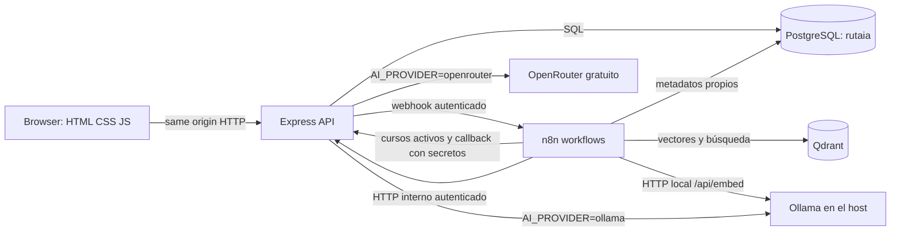

# Manual de continuidad de RutaIA

**Actualizado:** 3 de noviembre de 2026
**Propósito:** permitir que otra sesión retome el proyecto sin inferir estado, inventar cursos ni exponer secretos.

## 1. Qué es y qué está funcionando

La presentación académica editable y el guion de sustentación están en [docs/entrega/RutaIA_presentacion_final.pptx](entrega/RutaIA_presentacion_final.pptx).

RutaIA orienta a estudiantes a partir de un catálogo institucional. El navegador usa la API Express; PostgreSQL conserva cuentas, cursos, consultas y calificaciones; n8n coordina la indexación y el flujo RAG; Qdrant recupera candidatos vectoriales; Ollama genera embeddings localmente y puede generar texto. El profesor autorizó la excepción de Node.js/Express. Si el estudiante configura `AI_PROVIDER=openrouter`, el backend puede usar un modelo gratuito para la generación de texto; esa alternativa envía la pregunta y contexto al proveedor externo. El predeterminado sigue siendo Ollama.

**Autoría:** desarrollo individual del estudiante propietario del proyecto. No atribuir tareas, decisiones ni contribuciones a integrantes inexistentes. El enunciado conserva sus requisitos, aunque describa equipos.

**Datos reales:** las operaciones del producto deben leer y persistir datos en PostgreSQL y, en RAG, recuperar cursos/scores reales de Qdrant. Los datos sintéticos mencionados en la matriz son fixtures temporales de pruebas de integración con la base dedicada; no deben incorporarse al catálogo institucional ni citarse como recomendación real. Las respuestas generativas se permiten únicamente bajo el flujo RAG fundamentado en fuentes existentes.

Estado comprobado en este entorno (3 de noviembre de 2026, hora de Guatemala):

**Última actualización de continuidad:** Compose recreó únicamente backend y n8n para añadir `host.docker.internal:host-gateway`, necesario para que ambos alcancen Ollama desde Linux. Los cuatro servicios RutaIA quedaron saludables y n8n obtuvo HTTP 200 de Ollama (`bge-m3:latest`, `qwen2.5:3b`). El seed idempotente 009 se aplicó a la base local y el workflow de indexación se ejecutó manualmente: PostgreSQL tiene 32 cursos activos y Qdrant 32 puntos, con 0 UUID faltantes y 0 sobrantes. La recalibración BGE-M3 (32 cursos, 22 casos) mantiene `.535`; la consulta de IA obtiene tres fuentes oficiales y una E2E la terminó `Respondida`, con historial 200 y rating 201. Las pruebas actuales son en contenedores Linux con Windows como host; falta validar Docker Engine en Linux nativo.

En la revisión posterior se añadió un proxy interno autenticado de generación, se reconstruyó solo el servicio backend y `/health/ready` respondió `ready`. `npm test`: 33 pasan, cero fallan, una integración optativa omitida. OpenAPI: 26 paths, 29 operaciones y 100 refs; workflows: 28 nodos, 33 conexiones y 9 Code nodes válidos; `docker compose config --quiet` pasó. Una llamada real sintética al proxy local devolvió JSON correcto con 64 tokens; el intento de generación con 192 tokens excedió 120 s. No se hizo una llamada real a OpenRouter. La instancia n8n activa sigue usando la versión anterior hasta que se actualice su nodo de generación con los pasos de `automation/n8n/README.md`.

**4 de noviembre — verificación Linux y seguridad:** el mismo `npm ci`, `npm test`, `npm run validate:openapi`, `npm run validate:workflows` y `npm audit` pasó en un contenedor temporal Node `v22.23.4`; el repositorio se montó como solo lectura y las instalaciones fueron a tmpfs. `npm audit` quedó en 0 vulnerabilidades tras actualizar `js-yaml` y retirar `nodemon`; el script de desarrollo ahora usa `node --watch`. La imagen de producción se reconstruyó: `npm ci --omit=dev` reportó 0 vulnerabilidades, el backend se reemplazó y `/health/ready` respondió `ready`. Son pruebas Linux en contenedores sobre Windows, no una instalación nativa en Linux.

**Proveedor IA vigente:** el backend ahora selecciona `ollama` u `openrouter` desde `.env`; OpenRouter solo permite `openrouter/free` o un ID acabado en `:free`. La clave se entrega al backend por entorno y no se envía a n8n. Se ejecutaron pruebas unitarias con respuestas simuladas de ambos formatos, pero no una solicitud real a OpenRouter porque no se configuró una clave. El n8n activo del equipo todavía refleja la versión directa a Ollama; hay que actualizar el nodo de generación para que llame `/api/v1/internal/ai/chat` y asignarle la credencial de sincronización antes de cambiar a `AI_PROVIDER=openrouter`. Por tanto, el modo Ollama sigue siendo la ruta comprobada para la demostración actual.

- **Snapshot anterior a seed 009:** Docker Compose mostraba backend, n8n, PostgreSQL y Qdrant saludables. PostgreSQL y la API tenían 29 cursos activos; Qdrant tenía 29 puntos con 29 UUID únicos, sin puntos faltantes ni huérfanos. El workflow de consulta estaba activo; el indexador permanecía inactivo tras su ejecución manual.
- **RAG E2E vigente:** la consulta de IA terminó `Respondida` con tres cursos INTECAP oficiales; historial 200 y calificación 201. Se verificaron pregunta vacía (400) e historial de UUID inexistente (404) en pruebas anteriores. Los datos sintéticos se eliminaron al final.
- **Timeout corregido:** el primer E2E tras ampliar el límite a 768 tokens mostró que `qwen2.5:3b` alcanzaba el timeout HTTP de 300 s. La configuración activa ahora limita la salida a 192 tokens, respuestas breves y tres fuentes de contexto. Las pruebas sintéticas y la E2E positiva terminaron; no afirmar que la inferencia sea instantánea: esta consulta tomó 65 s.
- **Pruebas antes de esta revisión:** `npm test` 26 aprobadas, 0 fallidas, 1 integración opcional omitida; `npm run test:integration` 1/1 aprobada; OpenAPI 25 rutas, 28 operaciones y 95 refs; workflows 28 nodos, 33 conexiones y 9 Code nodes. Los resultados actuales están arriba.
- **Pendientes académicos:** con 32 cursos y umbral `.535`, la consulta de IA obtiene tres fuentes y pasó E2E. Web, Java/Spring, dashboards, automatización empresarial, seguridad web y contenedores siguen sin tres fuentes relevantes; mantener `Sin resultados` cuando falta evidencia. Automatización industrial no equivale a automatización administrativa. No se verificó una ficha institucional de Docker/Kubernetes con duración respaldada.
- **Frontend visual:** la UI tiene cobertura de API/sintaxis y existe una revisión parcial anterior de login/registro en Opera. La captura de Chrome de esta continuación se detuvo antes de capturar porque Computer Use no pudo validar la URL; catálogo y vistas autenticadas aún requieren inspección visual.

Las entradas siguientes conservan evidencia histórica anterior y se identifican como tal cuando difieren del estado vigente.

- **Verificación inicial (histórica):** la API y Qdrant tuvieron 27 y luego 29 cursos/puntos antes del seed 009. El estado actual de 32 cursos y 32 puntos se detalla arriba.
- **Cursos añadidos en esta continuación:** el seed idempotente 008 incorpora Automatización Industrial (360 h) e Instrumentista Industrial (540 h + 300 h de práctica separada) según la página de [especialidad industrial de INTECAP Baja Verapaz](https://www.intecap.edu.gt/centros/centrobajaverapaz/industrial/). Se aplicó a PostgreSQL `rutaia`; la API respondió 29 cursos. La integración de `rutaia_test` verificó nombres, horas, URLs, detalle público e idempotencia de ambos. El seed 009 agrega tres ofertas oficiales de IA con `duration_hours` calculado desde el calendario publicado; PostgreSQL, Qdrant y la E2E actuales usan 32 cursos.
- **Snapshot de sincronización antes de seed 009:** el usuario ejecutó el indexador; se compararon 29 UUID. En esta continuación el usuario ejecutó una nueva indexación, que dejó 32 cursos y 32 puntos, sin faltantes ni sobrantes.
- **Snapshot de cobertura anterior al seed 009:** la calibración de 21 casos/29 cursos mostraba IA 0/3. La última medición de 22 casos/32 cursos obtiene IA 3/3 y mantiene `.535`; las otras áreas pendientes se enumeran en la actualización vigente y en la matriz.
- **Pruebas de la revisión anterior:** `npm test` 26 aprobadas, 0 fallidas y 1 integración opcional omitida; `npm run test:integration` 1/1; OpenAPI 25 rutas, 28 operaciones y 95 refs; workflows 28 nodos, 33 conexiones y 9 Code nodes. E2E IA con tres fuentes oficiales, historial 200, rating 201 y limpieza sintética.
- 3 nov: `docker compose --env-file .env config --quiet` y `docker compose up --build -d` pasaron; los cuatro servicios RutaIA quedaron `healthy`. `/health/ready`, n8n `/healthz` y Qdrant `/readyz` respondieron HTTP 200.
- 3 nov: backend actualizado reconstruido y saludable. Ollama local tiene `bge-m3` y `qwen2.5:3b`; el contenedor n8n obtuvo HTTP 200 desde `host.docker.internal:11434/api/tags`.
- 3 nov: migración `004_course_source_url.sql` y seed idempotente `005_intecap_source_urls.sql` aplicados a PostgreSQL RutaIA; la API devolvió 20/20 cursos con URL oficial HTTPS. Backend reconstruido y `/health/ready` respondió `ready`.
- 3 nov: las 20 URLs del seed respondieron HTTP 200 desde `cursos.intecap.edu.gt`; el encabezado de cada ficha coincidió con el curso del catálogo.
- 3 nov: los dos workflows tienen 14 nodos y no se duplicaron; en n8n el workflow de consulta está activo y sincronizado con la versión local para Ollama, mientras el indexador permanece inactivo. El indexador real procesó 20 embeddings BGE-M3 (1024 dimensiones) y dejó 20 puntos Qdrant tras dos ejecuciones.
- 3 nov: prueba de reconciliación con el workflow real del indexador. Se desactivó temporalmente `Instalación de paneles fotovoltaicos`; tras ejecutar n8n, Qdrant pasó de 20 a 19 puntos y ya no devolvió su UUID. Al reactivarlo y repetir el flujo, Qdrant regresó a 20 puntos y el vector reapareció. Se confirmó el curso activo al final.
- 3 nov: usando esas cinco fuentes persistentes, una llamada local directa a Qwen generó `answer`, `summary` y `explanation` JSON válidos en 122.8 segundos. El curso y horas citados estaban en los payloads recuperados. Esta llamada no pasó por el workflow de consulta ni guardó una recomendación.
- `/health/ready` devolvió `ready`. Sondas desde contenedores recibieron HTTP 200 backend→n8n, backend→Qdrant, n8n→backend y n8n→Qdrant.
- 3 nov (estado previo al seed TIC): inspección de solo lectura del esquema PostgreSQL confirmó ocho tablas, 8 claves primarias, 7 foráneas, 17 `CHECK`, 4 `UNIQUE` y 21 índices. En esa verificación, la base y Qdrant tenían 20 ofertas/puntos; el snapshot actual de 24 se registra al inicio de esta sección.
- La migración `002_finite_similarity_score.sql` quedó aplicada en `rutaia` y `rutaia_test`; reemplaza el constraint de score para rechazar `NaN` y ambas infinitudes. La integración probó los tres rechazos y la migración repetida fue idempotente.
- La inspección visual autenticada sigue pendiente: el control local de escritorio no pudo verificar la URL de Chrome. La E2E posterior sí creó una cuenta sintética mediante API; se comprobó que sus datos y sesión fueron eliminados. No se enviaron formularios desde el navegador.
- 3 nov: `npm test` pasó 26/26, 0 fallidas y 1 integración optativa omitida. `npm run test:integration` pasó 1/1 contra `rutaia_test` en una corrida anterior; cubre auth/login, perfil, 20 cursos, CRUD, historial, callbacks y ratings.
- Comprobación actual: `docker compose ps` muestra backend, n8n, PostgreSQL y Qdrant `healthy`; backend y n8n se recrearon/reiniciaron durante las verificaciones de este turno.
- `npm run validate:openapi`: 25 paths, 28 operaciones coincidentes con routers/montajes de `app.js`, 95 referencias locales resueltas y schemas obligatorios para éxitos 200/201/202 y errores HTTP declarados.
- El frontend sirve las vistas de auth, inicio/consulta, catálogo, historial, perfil y administración. La carga de categorías recorre páginas; la UI solo declara logout exitoso tras respuesta del servidor.
- **RAG:** el workflow de consulta activo usa Ollama y mantiene las credenciales asignadas. Con umbral `0.535`, cocina italiana termina `Sin resultados` sin fuentes/recomendación (última prueba: 5 s). Automatización industrial termina `Respondida` en 65 s con tres fuentes institucionales pertinentes, historial y rating 201; en ambos casos los registros sintéticos se eliminaron. Un timeout anterior a 300 s motivó reducir la generación máxima a 192 tokens.

`healthy` demuestra disponibilidad de proceso/healthcheck, no significa que el RAG esté listo.

## 2. Arquitectura y conexiones



En Compose, los nombres DNS internos son `backend`, `postgres`, `qdrant` y `n8n`. El browser usa los puertos publicados en loopback: aplicación `APP_PORT` (3001 en esta PC; 3000 por defecto), PostgreSQL 5432, Qdrant 6333 y n8n 5678. No se deben publicar esos puertos directamente a Internet.

El backend sirve `frontend/` estáticamente y aplica las migraciones al iniciar. Cookie de sesión HttpOnly más `X-CSRF-Token` protegen las mutaciones. El browser no llama Qdrant, n8n ni Ollama directamente. n8n usa `host.docker.internal:11434` para alcanzar Ollama; la generación pasa por Express para mantener la clave externa fuera de n8n. Verifica que los servicios requeridos sean accesibles desde sus contenedores antes de activar workflows.

## 3. Mapa del repositorio

- `frontend/index.html`, `frontend/assets/css/styles.css`, `frontend/assets/js/app.js`: experiencia de login/registro, consulta, recomendaciones, catálogo, perfil, historial y vistas admin.
- `backend/src/app.js`: middleware, CORS, security headers, mounts de routers y estáticos.
- `backend/src/routes/`: endpoints de auth, cursos, estudiantes, consultas, recomendaciones y salud.
- `backend/src/controllers/`, `services/`, `repositories/`, `validators/`: HTTP, dominio, SQL y esquemas Zod.
- `backend/src/integrations/n8n/`: invocación de webhook desde Express.
- `backend/scripts/`: migración, promoción admin, runner de integración y validador OpenAPI.
- `database/migrations/001_initial_schema.sql`–`004_course_source_url.sql`: esquema, restricción finita para scores, clasificación INTECAP nullable separada del nivel RutaIA y URL oficial de cada curso, aplicados por el migrador versionado.
- `database/docker-init/001-n8n-schema.sql`: preparación del esquema PostgreSQL de n8n.
- `automation/n8n/index-courses.json`: indexación/reconciliación de cursos activos.
- `automation/n8n/answer-query.json`: consulta, recuperación, selección de fuentes, generación y callback.
- `docs/api/openapi.yaml`: contrato de API.
- `docs/architecture/`, `docs/testing/`: modelo, contexto, diagnóstico y evidencia.

Entidades relacionales principales: estudiantes y sesiones; cursos; consultas; recomendaciones y sus fuentes; ratings; registro de migraciones. Las FK, restricciones e índices están en la migración SQL; los embeddings viven en Qdrant, relacionados por UUID de curso, no en el browser.

## 3.1 Guía de lectura para estudiar y grabar

Lee las capas en este orden y muestra siempre la implementación real:

1. `backend/src/app.js`: middleware, rutas y frontend estático.
2. Un endpoint recorre `routes/` → `controllers/` → `validators/` → `services/` → `repositories/` → `db/pool.js`/PostgreSQL. Las validaciones usan Zod; las consultas SQL están en repositorios.
3. Registro/sesión: `auth.controller.register/login/logout`; `auth.service.register/login/logout`; `session.service.createSession/destroySession`; `password.service.hashPassword/verifyPassword`.
4. Cursos: `course.controller.list/adminList/get/adminGet/create/update/setStatus`; `course.service.getPublicList/getAdminList/getById/create/update/setActive`.
5. Consultas: `query.controller.create/get/list/studentHistory/callback`; `query.service.create/get/list/listStudentHistory/receiveCallback`; `integrations/n8n/client.js` inicia el webhook autenticado y el callback recibe el resultado.
6. Ratings/métricas: `rating.service.create`; `statistics.controller.get` y `statistics.repository.js`.

### Rutas útiles para la demostración

- Registro/sesión: `POST /api/v1/auth/register`, `POST /api/v1/auth/login`, `POST /api/v1/auth/logout`, `GET /api/v1/auth/me`.
- Catálogo: `GET /api/v1/courses`; admin: `GET/POST /api/v1/admin/courses`, `GET/PATCH /api/v1/admin/courses/{id}`, `PATCH /api/v1/admin/courses/{id}/status`.
- Consulta/historial: `POST/GET /api/v1/queries`, `GET /api/v1/queries/{id}`, `GET /api/v1/students/{id}/history`.
- Evaluación: `POST /api/v1/recommendations/{id}/rating`, `GET /api/v1/admin/statistics`.
- Integración n8n: `GET /api/v1/internal/courses/active`, `GET /api/v1/internal/rag/index-config`, `POST /api/v1/internal/n8n/results`.

### Persistencia, flujos y pruebas existentes

- Tablas: `students`, `sessions`, `courses`, `queries`, `recommendations`, `recommendation_sources`, `ratings`; `schema_migrations` la crea `backend/scripts/migrate.js`, que aplica en orden los archivos SQL versionados aún pendientes.
- `automation/n8n/index-courses.json`: 11 nodos desde lectura de catálogo/configuración, embeddings y upsert hasta reconciliación de inactivos.
- `automation/n8n/answer-query.json`: 14 nodos desde webhook autenticado y búsqueda Qdrant hasta respuesta fundamentada/callback o ramas Sin resultados/Error. Además de validarse estáticamente, el flujo E2E de consulta se probó con los casos Respondida y Sin resultados.
- `backend/tests/api.test.js`: “health responde sin declarar PostgreSQL listo”, “frontend estático se sirve desde el mismo origen”, “JSON malformado…” y “rutas inexistentes…”.
- `backend/tests/auth.test.js`: registro/login, hash, validación de cursos/perfil, pregunta vacía, callback con fuentes y rating.
- `backend/tests/n8n-code-nodes.test.js`: ejecuta con contexto simulado la selección RAG (actividad, score, duplicados y máximo cinco fuentes) y validación de embeddings. No ejecuta n8n ni usa cursos reales.
- `backend/tests/n8n-client.test.js`: verifica configuración requerida, códigos seguros para timeout/red/HTTP no exitoso y el payload autenticado con `fetch` simulado; no contacta n8n.
- `backend/tests/postgres.integration.test.js`: API, PostgreSQL, auth, historial propio/admin y aislamiento, 401 sin sesión, 404 para estudiante/historial inexistente, fuentes persistidas y filtro por estado, callbacks idempotentes `Respondida`/`Sin resultados`/`Error`, rechazo de fuentes inactivas (`N8N_INVALID_SOURCES`), rating y estadísticas sobre `rutaia_test`.
- `backend/scripts/validate-workflows.js`: verifica JSON, IDs/nombres, aristas, bifurcación de reconciliación con catálogo vacío y compilación de los nueve Code nodes; ejecutar `npm run validate:workflows` desde `backend/`.

Las pruebas con fixtures sintéticos demuestran contratos y persistencia de prueba, no cursos ni fuentes institucionales reales. Para material audiovisual, presenta únicamente lo que la pantalla, DB y workflow demuestren en vivo; identifica los pendientes de RAG como pendientes.

## 4. Variables y secretos

Copia `.env.example` a `.env` en la raíz. `.env` es local/ignorado y nunca se debe copiar a Git, Notion, logs o mensajes. El archivo de ejemplo usa `CHANGE_ME`; no lo uses para un entorno real.

| Variable | Para qué sirve |
| --- | --- |
| `NODE_ENV`, `PORT` | Modo y puerto de Express fuera de Compose; Compose fija el puerto del proceso interno a 3000. |
| `DATABASE_URL` | PostgreSQL de la API en ejecución local; Compose la construye con host `postgres`. |
| `POSTGRES_USER`, `POSTGRES_PASSWORD`, `POSTGRES_PORT` | Cuenta y puerto local de PostgreSQL. Contraseña URL-safe para la URL construida por Compose. |
| `SESSION_SECRET`, `SESSION_TTL_HOURS` | Firma/secreto de sesiones y duración. Secreto aleatorio de al menos 32 caracteres. |
| `FRONTEND_URL`, `APP_PORT` | Origen permitido por CORS y puerto publicado de la app. Si se usa 3001, pon `FRONTEND_URL=http://localhost:3001`. |
| `QDRANT_URL`, `QDRANT_COLLECTION` | URL/colección en ejecución local; Compose usa `http://qdrant:6333`. `rutaia_courses` es Cosine, 1024 dimensiones; contiene 32 puntos con UUID iguales a los cursos activos de PostgreSQL. |
| `N8N_QUERY_WEBHOOK_URL`, `N8N_WEBHOOK_SECRET` | Webhook que Express llama y su autenticación bearer. Compose usa `http://n8n:5678/webhook/rutaia-query`. |
| `N8N_CALLBACK_URL`, `N8N_CALLBACK_SECRET` | Callback interno que n8n invoca en Express y su secreto. Compose usa `http://backend:3000/api/v1/internal/n8n/results`. |
| `N8N_COURSE_SYNC_SECRET` | Protege las consultas internas de cursos/configuración para n8n. |
| `N8N_TIMEOUT_MS` | Timeout de petición desde Express hacia n8n. |
| `N8N_PORT`, `N8N_HOST`, `N8N_ENCRYPTION_KEY`, `GENERIC_TIMEZONE` | Interfaz y cifrado de credenciales n8n; fija una clave aleatoria de al menos 32 caracteres y no la cambies después de guardar credenciales. |
| `OLLAMA_BASE_URL` | Base URL para inferencia local; en Compose, `http://host.docker.internal:11434`. Backend y n8n reciben el mapping `host-gateway`; en Linux, Ollama debe escuchar en `0.0.0.0:11434`. |
| `OLLAMA_EMBEDDING_MODEL`, `OLLAMA_CHAT_MODEL` | IDs de modelos locales. Por defecto, `bge-m3` y `qwen2.5:3b`; descarga con `ollama pull`. Mantén el modelo de embeddings constante para indexación y consulta. |
| `AI_PROVIDER` | Proveedor de generación: `ollama` (local y predeterminado) u `openrouter`. Las embeddings siguen en Ollama. |
| `OPENROUTER_API_KEY`, `OPENROUTER_CHAT_MODEL` | Solo al usar OpenRouter. Clave privada en `.env`; el backend limita modelo al alias `openrouter/free` o a IDs terminados en `:free`. No se envía la clave a n8n. |
| `AI_CHAT_TIMEOUT_MS` | Límite de espera para generación; predeterminado 120 segundos, configurable hasta 180 segundos. |
| `RAG_MIN_SIMILARITY` | Umbral Qdrant. En el entorno local: `0.535`, calibrado con BGE-M3 y sondeos del flujo real. Repite `npm run calibrate:rag` tras cambiar catálogo/modelo.
| `RUTAIA_TEST_DATABASE_URL` | Solo runner de integración; loopback y base `/rutaia_test`. Nunca una base con información de uso real. |

Ollama se ejecuta localmente y no requiere clave ni cuenta. Las credenciales n8n autorizan webhooks internos entre backend y n8n. OpenRouter es opcional y transmite la pregunta/contexto al proveedor externo; usa preguntas sintéticas y verifica que el modelo gratuito siga disponible antes de depender de él.

Secretos distintos para sesión, cifrado n8n, webhook, callback y sincronización. Para el password PostgreSQL usa letras, números, `_` y `-` para que la URL construida no se rompa.

## 5. Instalación, ejecución y apagado

### Preparar

1. Instala/abre Docker Desktop con motor Linux y clona/abre este repositorio.
2. Si `.env` no existe, copia `.env.example` a `.env`; sustituye **todos** los `CHANGE_ME` por secretos aleatorios. No reemplaces un `.env` existente con secretos válidos.
3. Comprueba que `APP_PORT` esté libre. En esta PC se utiliza 3001 y el `FRONTEND_URL` debe coincidir.
4. El entorno local usa `RAG_MIN_SIMILARITY=0.535`, candidato contrastado con consultas de cocina italiana y gastronomía en el workflow. El margen de score observado es pequeño; vuelve a evaluarlo si cambia catálogo o modelo.

### Levantar y comprobar

Desde la raíz:

```powershell
docker compose --env-file .env config --quiet
docker compose up --build -d
docker compose ps
Invoke-RestMethod http://localhost:3001/health
Invoke-RestMethod http://localhost:3001/health/ready
Invoke-RestMethod 'http://localhost:3001/api/v1/courses?limit=100&page=1'
Invoke-RestMethod http://localhost:6333/readyz
```

Cambia `3001` por `3000` cuando uses el puerto predeterminado. En n8n entra en `http://localhost:5678`; la primera vez hay que completar la creación normal de la cuenta propietaria desde su interfaz.

Logs, sin imprimir `.env`:

```powershell
docker compose logs --tail 100 backend
docker compose logs --tail 100 n8n
docker compose logs --tail 100 postgres
docker compose logs --tail 100 qdrant
```

Para detener conservando datos: `docker compose stop`. Para reanudar: `docker compose start`. `docker compose down` elimina contenedores/red, pero conserva los volúmenes por defecto. **No ejecutar `docker compose down -v`** salvo que deliberadamente se quiera borrar el almacenamiento persistente.

### Desarrollo local sin contenedor backend

Con PostgreSQL de Compose iniciado y `.env` apuntando a `localhost:5432`, desde `backend/` ejecuta `npm ci`, luego `npm run dev`. No ejecutes simultáneamente el backend local y el de Compose en el mismo puerto host; cambia `APP_PORT` o detén solo el backend de Compose si realmente vas a hacer esa prueba.

## 6. Pruebas reproducibles

Desde `backend/`:

```powershell
npm ci
npm test
npm run validate:openapi
npm run validate:workflows
npm audit
npm run calibrate:rag
```

En la última verificación, `npm test` pasó 33 pruebas, ninguna falló y una integración opcional se omitió; `npm run test:integration` pasó 1/1 contra `rutaia_test`; `npm audit` reportó 0 vulnerabilidades. La suite también pasó dentro del contenedor `node:22-alpine`. Para Postgres/API real:

1. Inicia Compose.
2. Configura `RUTAIA_TEST_DATABASE_URL` en `.env` con `localhost`/`127.0.0.1`, usuario local y nombre final `/rutaia_test`, por ejemplo `postgresql://rutaia_user:<contraseña-url-safe>@localhost:5432/rutaia_test`.
3. Si la DB todavía no existe, créala una sola vez: `docker exec rutaia-postgres-1 createdb -U rutaia_user rutaia_test`.
4. Ejecuta `npm run test:integration` desde `backend/`.

El runner valida host/nombre de DB antes de conectarse. La suite migra la base dedicada y elimina sus fixtures. En la verificación actual pasó 1/1. No la apuntes a `rutaia` ni a datos reales.

`npm run validate:openapi` valida YAML, referencias locales y operaciones en comparación con declaraciones de routers/montajes que lee de `backend/src/app.js`; no sustituye una revisión semántica completa de cada esquema de request y response.

`npm run calibrate:rag` requiere la API en `http://localhost:3001` (o `CATALOG_URL`) y Ollama local. Embebe el catálogo actual y los casos calibrados con BGE-M3. El texto enviado para cada curso coincide con el workflow de indexación. Ejecución fresca del 4 nov: 32 cursos y 22 casos, máximo tercer score OOD `0.5292`, mínimo tercer score positivo relevante `0.5396`, ventana `0.5292–0.5396`; se mantiene `.535`, con margen estrecho. La diferencia frente a la cifra histórica `0.4569–0.5740` no se puede atribuir a un cambio concreto porque no se conservó snapshot de esos datos. Las siete consultas académicas tienen 1,1,2,1,3,1,0 resultados sobre el umbral. Solo IA alcanza tres fuentes; automatización empresarial encuentra una oferta industrial, que no equivale a automatización administrativa.

## 7. Flujo principal y qué falta probar

1. **Registro/inicio:** Express valida los campos, guarda hash de contraseña, crea sesión y cookie HttpOnly, devuelve CSRF. Auth, logout y perfil tienen cobertura API/DB; la UI de cierre conserva sesión si el servidor falla.
 2. **Catálogo:** consulta solo cursos activos en PostgreSQL; admite texto, categoría, nivel y paginación. CRUD admin puede crear/editar/activar/desactivar. La UI obtiene categorías de todas las páginas y muestra enlace a la ficha oficial INTECAP cuando `sourceUrl` apunta al dominio institucional HTTPS. `level` conserva dificultad didáctica RutaIA y `intecapCareerType` conserva CTO/CTM/CTMS por separado; ofertas modulares sin tipo de carrera usan `NULL`. El catálogo actual tiene 32 cursos en nueve seeds; la integración cubre el seed 009, sus duraciones calculadas, URLs y detalle.
3. **Consulta:** estudiante autenticado envía pregunta con CSRF. Express crea registro y llama el webhook autenticado de n8n.
   - La UI consulta el estado cada 2 segundos hasta 180 segundos antes de dejar un mensaje de espera y permitir revisar el historial. El E2E RAG reciente tardó 65 segundos con Qwen 2.5 3B local; la duración depende del equipo.
4. **RAG ejecutado:** n8n genera el embedding con Ollama, consulta candidatos en Qdrant, revalida cursos activos en PostgreSQL, aplica umbral y pasa las tres fuentes elegibles mejor clasificadas a generación (mínimo de tres). La prueba E2E local cubrió `Sin resultados` (cocina italiana) y `Respondida` (automatización industrial/PLC); esta última persistió tres fuentes oficiales, historial y calificación 201. Las cuentas de prueba se eliminaron.
5. **Historial:** cada estudiante solo puede consultar sus consultas y resultados. La integración API/DB prueba historial propio, aislamiento entre cuentas, admin, 401 sin sesión y 404 para estudiante inexistente.
6. **Calificación:** la UI ofrece rating 1–5 para una recomendación; el backend persiste una sola por recomendación. En la prueba E2E de gastronomía el rating devolvió HTTP 201 y se limpió junto con los datos temporales.

Las pruebas de callbacks con fixtures en PostgreSQL validan contrato y persistencia, pero no sustituyen la prueba integral. Una ejecución anterior a Ollama falló por HTTP 401 de OpenRouter y un modelo de embedding desactualizado. El workflow activo usa ahora `/api/embed` y `/api/chat` de Ollama, conserva las credenciales de webhook, sincronización y callback y limita la generación a 192 tokens. El timeout anterior de 300 s se observó y corrigió; la E2E positiva actual pasó en 65 s, y la negativa de cocina en 5 s. La evidencia está en la matriz de aceptación.

## 8. Problemas pendientes confirmados

1. **Frontend:** la lógica tiene cobertura de API/sintaxis; falta revisar visualmente vistas autenticadas en escritorio y móvil. La herramienta de escritorio se detuvo antes de capturar porque no pudo validar la URL de Chrome; no se confirmó ningún ajuste faltante en Work settings.
2. **Sincronía de cursos:** la reconciliación al desactivar/reactivar un curso se probó (20→19→20); la consulta contrasta Qdrant con cursos activos en PostgreSQL. El usuario informó repetir la indexación con 32 cursos; el 4 nov los conteos se verificaron por API (32 activos/32 puntos). No se inspeccionó el ID de la ejecución de repetición en n8n.
3. **Cobertura académica RAG:** IA obtuvo tres fuentes y pasó E2E; cocina termina `Sin resultados`. Web, Java/Spring, dashboards, automatización empresarial, seguridad y contenedores todavía no reúnen tres fuentes. Ampliar catálogo solo con cursos y duración respaldados por fuentes institucionales.
4. **Contrato/API:** el validador confirma YAML, referencias, operaciones y presencia de schemas, no valida automáticamente cada payload HTTP real contra JSON Schema. Ampliar la validación si se requiere evidencia de contrato ejecutable.

## 9. Cómo continuar en la próxima sesión

1. Mantén el trabajo en `trabajo`; revisa `git status`, commit y ramas. `main` es estable; integra commits revisados por fast-forward a `dev`. No reescribas `main`.
2. Los workflows están sincronizados por sus IDs existentes. El de consulta está activo; el indexador está inactivo. Las credenciales están asignadas y Ollama usa `Authentication: None`. No reimportes los JSON.
3. La indexación actual coincide 32/32; la repetición 32→32 fue reportada por el usuario y se verificó el conteo final, aunque no el registro de ejecución n8n. La reconciliación 20→19→20 ya se probó. Ampliar la cobertura académica con ofertas oficiales verificables sin relajar el filtro.
4. Completa revisión del frontend en escritorio y móvil, incluyendo registro, login, catálogo/filtros, consulta, fuentes, historial, perfil, calificación y logout/error.
5. Si amplías el contrato OpenAPI, añade verificación de payloads HTTP contra schemas; luego vuelve a correr las validaciones. Revisa cambios y secretos y conserva commits localmente. No hacer push sin instrucción explícita.

## 10. Ramas y conservación

Usa `git status`, `git log` y `git branch -vv` como fuente de verdad al retomar. Mantén `trabajo` para desarrollo, integra cambios revisados por fast-forward en `dev` y reserva `main` para la versión estable. En este ciclo el usuario pidió conservar cambios localmente y no hacer push/publicación remota; respeta esa restricción. Evita `reset --hard`, `clean -fd`, `down -v` y cualquier operación que borre el trabajo o los volúmenes.
