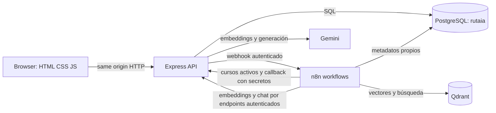

# Manual de continuidad de RutaIA

**Actualizado:** 6 de noviembre de 2026
**Propósito:** permitir que otra sesión retome el proyecto sin inferir estado, inventar cursos ni exponer secretos.

## 1. Qué es y qué está funcionando

La presentación académica editable y el guion de sustentación están en [docs/entrega/RutaIA_presentacion_final.pptx](entrega/RutaIA_presentacion_final.pptx).

RutaIA orienta a estudiantes a partir de un catálogo institucional. El navegador usa la API Express; PostgreSQL conserva cuentas, cursos, consultas y calificaciones; n8n coordina la indexación y el flujo RAG; Qdrant recupera candidatos vectoriales; Gemini es el proveedor configurado para embeddings y generación mediante proxies del backend. El profesor autorizó la excepción de Node.js/Express.

**Estado comprobado:** `npm test` pasa con 63 aprobadas, 0 fallidas y 1 integración opcional omitida; `npm run test:integration` pasa 1/1; OpenAPI valida 32 rutas, 35 operaciones y 120 referencias; los workflows versionados validan 40 nodos y 45 conexiones; `npm audit` reporta cero vulnerabilidades. Compose valida y el backend responde `/health/ready` con `ready`. La calibración real de Gemini sobre 37 cursos y 22 consultas dio la ventana `0.6347–0.6484`; `RAG_MIN_SIMILARITY=0.642` permanece provisional. La E2E real con Gemini publicado terminó `Respondida`, guardó tres fuentes y apareció en el historial; la cuenta y consulta temporales se limpiaron. Se cambió el modelo retirado `gemini-2.5-flash-lite` a `gemini-3.5-flash-lite` y se reconstruyó el backend. Qdrant tiene 37 UUID activos en `rutaia_courses_gemini_1536` (1536 dimensiones); la colección anterior `rutaia_courses` (38 puntos/1024 dimensiones) se conservó intacta. Quedan dos eventos `delete` pendientes en la cola incremental. En n8n, el responder Gemini está publicado y el indexador continúa despublicado.

Las notas siguientes con fechas anteriores describen evidencia histórica y no deben interpretarse como validación del proveedor Gemini ni del índice actual.

**Implementaciones locales (5 nov):** se añadieron JWT Bearer opcional (sin cambiar la sesión-cookie predeterminada), filtros vectoriales por categoría/nivel, memoria limitada a las tres respuestas más recientes del mismo estudiante, exportación CSV protegida por propietario y sincronización incremental con outbox PostgreSQL. Las pruebas unitarias cubren estos contratos. La migración 005 figura aplicada en `rutaia` y `rutaia_test`; el workflow incremental y los JSON Gemini siguen inactivos y la instancia n8n no se modificó. Compose valida con JWT opcional. Consulta e indexación rechazan cualquier colección distinta de `rutaia_courses_gemini_1536`.

**Actualización posterior de n8n:** la nota de arriba sobre la instancia sin modificar corresponde al cierre de aquella etapa. Después, el indexador quedó despublicado, el responder Gemini se publicó con las credenciales verificadas y la E2E se completó correctamente; la consulta de prueba quedó limpiada.

**Autoría:** desarrollo individual del estudiante propietario del proyecto. No atribuir tareas, decisiones ni contribuciones a integrantes inexistentes. El enunciado conserva sus requisitos, aunque describa equipos.

**Datos reales:** las operaciones del producto deben leer y persistir datos en PostgreSQL y, en RAG, recuperar cursos/scores reales de Qdrant. Los datos sintéticos mencionados en la matriz son fixtures temporales de pruebas de integración con la base dedicada; no deben incorporarse al catálogo institucional ni citarse como recomendación real. Las respuestas generativas se permiten únicamente bajo el flujo RAG fundamentado en fuentes existentes.

Estado comprobado en este entorno (3 de noviembre de 2026, hora de Guatemala):

**Estado local (4 nov):** Compose tiene los cuatro servicios saludables y `/health/ready`, n8n `/healthz` y Qdrant `/readyz` responden HTTP 200. PostgreSQL tiene 38 cursos activos (37 con fuente HTTPS), Qdrant conserva los 38 puntos de la colección BGE-M3 de 1024 dimensiones y no se modificó esa colección. La instancia n8n guardada tiene activa la consulta RAG con Ollama y el indexador inactivo con Ollama; los JSON versionados actuales usan OpenRouter, pero aún no se importaron a la instancia. El nuevo modelo devolvió inicialmente dimensión 2048; después sus solicitudes quedaron limitadas por HTTP 429. La calibración y una respuesta completa de chat siguen pendientes. Los contenedores Linux corren sobre Docker Desktop en Windows; no se ha probado un host Linux nativo en este ciclo.

**Mínimos de datos del PDF oficial:** hay 3 cuentas con rol Estudiante de 10 y 2 calificaciones de 5; hay 10 preguntas distintas, 38 cursos activos (37 con fuente), 17 categorías y 3 niveles. Faltan 7 estudiantes y 3 calificaciones de personas y valoraciones reales; no crear cuentas ni ratings sintéticos para cumplir la rúbrica.

En la revisión posterior se añadió un proxy interno autenticado de generación, se reconstruyó solo el servicio backend y `/health/ready` respondió `ready`. `npm test`: 33 pasan, cero fallan, una integración optativa omitida. OpenAPI: 26 paths, 29 operaciones y 100 refs; workflows: 28 nodos, 33 conexiones y 9 Code nodes válidos; `docker compose config --quiet` pasó. Una llamada real sintética al proxy local devolvió JSON correcto con 64 tokens; el intento de generación con 192 tokens excedió 120 s. No se hizo una llamada real a OpenRouter. La instancia n8n activa sigue usando la versión anterior hasta que se actualice su nodo de generación con los pasos de `automation/n8n/README.md`.

**4 de noviembre — verificación Linux y seguridad:** el mismo `npm ci`, `npm test`, `npm run validate:openapi`, `npm run validate:workflows` y `npm audit` pasó en un contenedor temporal Node `v22.23.4`; el repositorio se montó como solo lectura y las instalaciones fueron a tmpfs. `npm audit` quedó en 0 vulnerabilidades tras actualizar `js-yaml` y retirar `nodemon`; el script de desarrollo ahora usa `node --watch`. La imagen de producción se reconstruyó: `npm ci --omit=dev` reportó 0 vulnerabilidades, el backend se reemplazó y `/health/ready` respondió `ready`. Son pruebas Linux en contenedores sobre Windows, no una instalación nativa en Linux.

**Estado de n8n:** la exportación de solo lectura de la instancia confirmó dos workflows de 14 nodos: `RutaIA - Responder consultas RAG` está activa y usa Ollama/Qdrant; `RutaIA - Indexar cursos activos` está inactiva y usa Ollama/Qdrant. Los JSON versionados están configurados para los proxies OpenRouter, pero aún no se importaron en la instancia. La evidencia histórica con Ollama no valida la migración actual.

- **Snapshot anterior a seed 009:** Docker Compose mostraba backend, n8n, PostgreSQL y Qdrant saludables. PostgreSQL y la API tenían 29 cursos activos; Qdrant tenía 29 puntos con 29 UUID únicos, sin puntos faltantes ni huérfanos. El workflow de consulta estaba activo; el indexador permanecía inactivo tras su ejecución manual.
- **RAG E2E vigente:** la consulta de IA terminó `Respondida` con tres cursos INTECAP oficiales; historial 200 y calificación 201. Se verificaron pregunta vacía (400) e historial de UUID inexistente (404) en pruebas anteriores. Los datos sintéticos se eliminaron al final.
- **Timeout corregido:** el primer E2E tras ampliar el límite a 768 tokens mostró que `qwen2.5:3b` alcanzaba el timeout HTTP de 300 s. La configuración activa ahora limita la salida a 192 tokens, respuestas breves y tres fuentes de contexto. Las pruebas sintéticas y la E2E positiva terminaron; no afirmar que la inferencia sea instantánea: esta consulta tomó 65 s.
- **Pruebas antes de esta revisión:** `npm test` 26 aprobadas, 0 fallidas, 1 integración opcional omitida; `npm run test:integration` 1/1 aprobada; OpenAPI 25 rutas, 28 operaciones y 95 refs; workflows 28 nodos, 33 conexiones y 9 Code nodes. Los resultados actuales están arriba.
- **Pendientes académicos:** con 38 cursos y umbral `.535`, solo IA obtiene tres fuentes claramente pertinentes entre las siete preguntas medidas. Java/Spring queda en 1/3, dashboards en 2/3 y web en 1/3; automatización empresarial encuentra una fuente industrial (no equivalente), y contenedores 0/3. La pregunta de seguridad web obtiene tres cursos generales de ciberseguridad/Fortinet, pero no demuestra seguridad de aplicaciones web. No se verificó una ficha institucional de Docker/Kubernetes con duración respaldada. No reducir el umbral ni usar cursos no relacionados.
- **Frontend visual:** se revisaron las vistas autenticadas principales y de administración en el navegador; no se observaron errores de consola al navegar. La revisión de escritorio y móvil de flujos mutables completos (consulta, calificación y logout) sigue pendiente.

Las entradas siguientes conservan evidencia histórica anterior y se identifican como tal cuando difieren del estado vigente.

- **Verificación inicial (histórica):** la API y Qdrant tuvieron 27, 29, 32 y 35 cursos/puntos en hitos previos. El estado actual de 38 cursos y 38 puntos se detalla arriba.
- **Cursos añadidos en esta continuación:** el seed idempotente 008 incorpora Automatización Industrial e Instrumentista Industrial según la página de [especialidad industrial de INTECAP Baja Verapaz](https://www.intecap.edu.gt/centros/centrobajaverapaz/industrial/). Los seeds 009–010 agregan IA, Power BI intermedio y dos ofertas Fortinet. El seed 011 agrega [Lenguaje de programación Java (E-learning)](https://cursos.intecap.edu.gt/detalle/45278/2026) (40 horas programadas) y [Power BI básico](https://cursos.intecap.edu.gt/detalle/43108/2026) (20 horas programadas), calculadas de sus horarios oficiales; las fichas no publican horas curriculares totales. La integración de `rutaia_test` cubre seed 011, detalle público, horas, enlaces e idempotencia.
- **Estado de sincronización actual:** PostgreSQL tiene 38 cursos activos y Qdrant 38 puntos, cero faltantes y cero huérfanos. El seed 011 se aplicó por segunda vez de forma idempotente; ambos cursos ya están indexados. El workflow indexador permanece inactivo para ejecución manual, según autorización docente.
- **Calibración posterior a seed 011:** 22 casos y 38 cursos. Los conteos de las siete preguntas son 1,1,2,1,3,3,0 sobre `.535`; Java nuevo queda en 0.5302 para Java/Spring, bajo el umbral, y Power BI básico no eleva dashboards de 2/3. Los detalles se registran en la matriz de aceptación.
- **Pruebas de la revisión anterior:** `npm test` 26 aprobadas, 0 fallidas y 1 integración opcional omitida; `npm run test:integration` 1/1; OpenAPI 25 rutas, 28 operaciones y 95 refs; workflows 28 nodos, 33 conexiones y 9 Code nodes. E2E IA con tres fuentes oficiales, historial 200, rating 201 y limpieza sintética.
- 3 nov: `docker compose --env-file .env config --quiet` y `docker compose up --build -d` pasaron; los cuatro servicios RutaIA quedaron `healthy`. `/health/ready`, n8n `/healthz` y Qdrant `/readyz` respondieron HTTP 200.
- 3 nov: backend actualizado reconstruido y saludable. Ollama local tiene `bge-m3` y `qwen2.5:3b`; el contenedor n8n obtuvo HTTP 200 desde `host.docker.internal:11434/api/tags`.
- 3 nov: migración `004_course_source_url.sql` y seed idempotente `005_intecap_source_urls.sql` aplicados a PostgreSQL RutaIA; la API devolvió 20/20 cursos con URL oficial HTTPS. Backend reconstruido y `/health/ready` respondió `ready`.
- 3 nov: las 20 URLs del seed respondieron HTTP 200 desde `cursos.intecap.edu.gt`; el encabezado de cada ficha coincidió con el curso del catálogo.
- 3 nov: los dos workflows tienen 14 nodos y no se duplicaron; en n8n el workflow de consulta está activo y sincronizado con la versión local para Ollama, mientras el indexador permanece inactivo. El indexador real procesó 20 embeddings BGE-M3 (1024 dimensiones) y dejó 20 puntos Qdrant tras dos ejecuciones.
- 3 nov: prueba de reconciliación con el workflow real del indexador. Se desactivó temporalmente `Instalación de paneles fotovoltaicos`; tras ejecutar n8n, Qdrant pasó de 20 a 19 puntos y ya no devolvió su UUID. Al reactivarlo y repetir el flujo, Qdrant regresó a 20 puntos y el vector reapareció. Se confirmó el curso activo al final.
- 3 nov: usando esas cinco fuentes persistentes, una llamada local directa a Qwen generó `answer`, `summary` y `explanation` JSON válidos en 122.8 segundos. El curso y horas citados estaban en los payloads recuperados. Esta llamada no pasó por el workflow de consulta ni guardó una recomendación.
- `/health/ready` devolvió `ready`. Sondas desde contenedores recibieron HTTP 200 backend→n8n, backend→Qdrant, n8n→backend y n8n→Qdrant.
- 3 nov (estado previo al seed TIC): inspección de solo lectura del esquema PostgreSQL confirmó ocho tablas, 8 claves primarias, 7 foráneas, 17 `CHECK`, 4 `UNIQUE` y 21 índices. En esa verificación, la base y Qdrant tenían 20 ofertas/puntos; el snapshot actual de 24 se registra al inicio de esta sección.
- La migración `002_finite_similarity_score.sql` quedó aplicada en `rutaia` y `rutaia_test`; reemplaza el constraint de score para rechazar `NaN` y ambas infinitudes. La integración probó los tres rechazos y la migración repetida fue idempotente.
- La inspección visual autenticada sigue pendiente: el control local de escritorio no pudo verificar la URL de Chrome. La E2E posterior sí creó una cuenta sintética mediante API; se comprobó que sus datos y sesión fueron eliminados. No se enviaron formularios desde el navegador.
- 3 nov: `npm test` pasó 26/26, 0 fallidas y 1 integración optativa omitida. `npm run test:integration` pasó 1/1 contra `rutaia_test` en una corrida anterior; cubre auth/login, perfil, 20 cursos, CRUD, historial, callbacks y ratings.
- Comprobación actual: `docker compose ps` muestra backend, n8n, PostgreSQL y Qdrant `healthy`; backend y n8n se recrearon/reiniciaron durante las verificaciones de este turno.
- `npm run validate:openapi`: 25 paths, 28 operaciones coincidentes con routers/montajes de `app.js`, 95 referencias locales resueltas y schemas obligatorios para éxitos 200/201/202 y errores HTTP declarados.
- El frontend sirve las vistas de auth, inicio/consulta, catálogo, historial, perfil y administración. La carga de categorías recorre páginas; la UI solo declara logout exitoso tras respuesta del servidor.
- **RAG:** el workflow de consulta activo usa Ollama y mantiene las credenciales asignadas. Con umbral `0.535`, cocina italiana termina `Sin resultados` sin fuentes/recomendación (última prueba: 5 s). Automatización industrial termina `Respondida` en 65 s con tres fuentes institucionales pertinentes, historial y rating 201; en ambos casos los registros sintéticos se eliminaron. Un timeout anterior a 300 s motivó reducir la generación máxima a 192 tokens.

`healthy` demuestra disponibilidad de proceso/healthcheck, no significa que el RAG esté listo.

## 2. Arquitectura y conexiones



En Compose, los nombres DNS internos son `backend`, `postgres`, `qdrant` y `n8n`. El browser usa los puertos publicados en loopback: aplicación `APP_PORT` (3001 en esta PC; 3000 por defecto), PostgreSQL 5432, Qdrant 6333 y n8n 5678. No se deben publicar esos puertos directamente a Internet.

El backend sirve `frontend/` estáticamente y aplica las migraciones al iniciar. Cookie de sesión HttpOnly más `X-CSRF-Token` protegen las mutaciones. El browser no llama Qdrant, n8n ni Gemini directamente. n8n usa endpoints internos autenticados de Express para embeddings y generación; solo el backend lee `GEMINI_API_KEY`.

## 3. Mapa del repositorio

- `frontend/index.html`, `frontend/assets/css/styles.css`, `frontend/assets/js/app.js`: experiencia de login/registro, consulta, recomendaciones, catálogo, perfil, historial y vistas admin.
- `backend/src/app.js`: middleware, CORS, security headers, mounts de routers y estáticos.
- `backend/src/routes/`: endpoints de auth, cursos, estudiantes, consultas, recomendaciones y salud.
- `backend/src/controllers/`, `services/`, `repositories/`, `validators/`: HTTP, dominio, SQL y esquemas Zod.
- `backend/src/integrations/n8n/`: invocación de webhook desde Express.
- `backend/scripts/`: migración, promoción admin, runner de integración y validador OpenAPI.
- `database/migrations/001_initial_schema.sql`–`005_course_qdrant_sync_outbox.sql`: esquema, restricciones para scores, clasificación INTECAP, URL oficial y outbox incremental de cursos, aplicados por el migrador versionado.
- `database/docker-init/001-n8n-schema.sql`: preparación del esquema PostgreSQL de n8n.
- `automation/n8n/index-courses.json`: indexación/reconciliación de cursos activos.
- `automation/n8n/answer-query.json`: consulta, recuperación, selección de fuentes, generación y callback.
- `automation/n8n/sync-course-events.json`: workflow incremental de eventos de cursos, inactivo hasta configurar y validar Gemini/Qdrant.
- `docs/api/openapi.yaml`: contrato de API.
- `docs/architecture/`, `docs/testing/`: modelo, contexto, diagnóstico y evidencia.

Entidades relacionales principales: estudiantes y sesiones; cursos; consultas; recomendaciones y sus fuentes; ratings; registro de migraciones. Las FK, restricciones e índices están en la migración SQL; los embeddings viven en Qdrant, relacionados por UUID de curso, no en el browser.

## 3.1 Guía de lectura para estudiar y grabar

Lee las capas en este orden y muestra siempre la implementación real:

1. `backend/src/app.js`: middleware, rutas y frontend estático.
2. Un endpoint recorre `routes/` → `controllers/` → `validators/` → `services/` → `repositories/` → `db/pool.js`/PostgreSQL. Las validaciones usan Zod; las consultas SQL están en repositorios.
3. Registro/sesión y perfil: `account.controller.register/login/logout/updateMe`; `account.service.register/login/logout/updateProfile`; `session.service.createSession/destroySession`; `password.service.hashPassword/verifyPassword`.
4. Cursos: `course.controller.list/adminList/get/adminGet/create/update/setStatus`; `course.service.getPublicList/getAdminList/getById/create/update/setActive`.
5. Consultas: `query.controller.create/get/list/studentHistory/callback`; `query.service.create/get/list/listStudentHistory/receiveCallback`; `integrations/n8n/client.js` inicia el webhook autenticado y el callback recibe el resultado.
6. Ratings/métricas: `rating.service.create`; `statistics.controller.get` y `statistics.repository.js`.

### Rutas útiles para la demostración

- Registro/sesión: `POST /api/v1/auth/register`, `POST /api/v1/auth/login`, `POST /api/v1/auth/logout`, `GET /api/v1/auth/me`.
- Catálogo: `GET /api/v1/courses`; admin: `GET/POST /api/v1/admin/courses`, `GET/PATCH /api/v1/admin/courses/{id}`, `PATCH /api/v1/admin/courses/{id}/status`.
- Consulta/historial: `POST/GET /api/v1/queries`, `GET /api/v1/queries/{id}`, `GET /api/v1/students/{id}/history`.
- Evaluación: `POST /api/v1/recommendations/{id}/rating`, `GET /api/v1/admin/statistics`.
- Integración n8n: `GET /api/v1/internal/courses/active`, `GET /api/v1/internal/rag/index-config`, `POST /api/v1/internal/n8n/results`.

### Persistencia, flujos y pruebas existentes

- Tablas: `students`, `sessions`, `courses`, `queries`, `recommendations`, `recommendation_sources`, `ratings`; `schema_migrations` la crea `backend/scripts/migrate.js`, que aplica en orden los archivos SQL versionados aún pendientes.
- `automation/n8n/index-courses.json`: 11 nodos desde lectura de catálogo/configuración, embeddings y upsert hasta reconciliación de inactivos.
- `automation/n8n/answer-query.json`: 14 nodos desde webhook autenticado y búsqueda Qdrant hasta respuesta fundamentada/callback o ramas Sin resultados/Error. Además de validarse estáticamente, el flujo E2E de consulta se probó con los casos Respondida y Sin resultados.
- `backend/tests/api.test.js`: “health responde sin declarar PostgreSQL listo”, “frontend estático se sirve desde el mismo origen”, “JSON malformado…” y “rutas inexistentes…”.
- `backend/tests/auth.test.js`: registro/login, hash, validación de cursos/perfil, pregunta vacía, callback con fuentes y rating.
- `backend/tests/n8n-code-nodes.test.js`: ejecuta con contexto simulado la selección RAG (actividad, score, duplicados y máximo cinco fuentes) y validación de embeddings. No ejecuta n8n ni usa cursos reales.
- `backend/tests/n8n-client.test.js`: verifica configuración requerida, códigos seguros para timeout/red/HTTP no exitoso y el payload autenticado con `fetch` simulado; no contacta n8n.
- `backend/tests/postgres.integration.test.js`: API, PostgreSQL, auth, historial propio/admin y aislamiento, 401 sin sesión, 404 para estudiante/historial inexistente, fuentes persistidas y filtro por estado, callbacks idempotentes `Respondida`/`Sin resultados`/`Error`, rechazo de fuentes inactivas (`N8N_INVALID_SOURCES`), rating y estadísticas sobre `rutaia_test`.
- `backend/scripts/validate-workflows.js`: verifica JSON, IDs/nombres, aristas, bifurcación de reconciliación con catálogo vacío y compilación de los nueve Code nodes; ejecutar `npm run validate:workflows` desde `backend/`.

Las pruebas con fixtures sintéticos demuestran contratos y persistencia de prueba, no cursos ni fuentes institucionales reales. Para material audiovisual, presenta únicamente lo que la pantalla, DB y workflow demuestren en vivo; identifica los pendientes de RAG como pendientes.

## 4. Variables y secretos

Copia `.env.example` a `.env` en la raíz. `.env` es local/ignorado y nunca se debe copiar a Git, Notion, logs o mensajes. El archivo de ejemplo usa `CHANGE_ME`; no lo uses para un entorno real.

| Variable | Para qué sirve |
| --- | --- |
| `NODE_ENV`, `PORT` | Modo y puerto de Express fuera de Compose; Compose fija el puerto del proceso interno a 3000. |
| `DATABASE_URL` | PostgreSQL de la API en ejecución local; Compose la construye con host `postgres`. |
| `POSTGRES_USER`, `POSTGRES_PASSWORD`, `POSTGRES_PORT` | Cuenta y puerto local de PostgreSQL. Contraseña URL-safe para la URL construida por Compose. |
| `SESSION_SECRET`, `SESSION_TTL_HOURS` | Firma/secreto de sesiones y duración. Secreto aleatorio de al menos 32 caracteres. |
| `JWT_SECRET`, `JWT_TTL_SECONDS` | JWT Bearer opcional para clientes que no usan cookie; secreto aleatorio propio de al menos 32 caracteres, distinto de `SESSION_SECRET`. Sin él, la sesión-cookie sigue disponible y `/api/v1/auth/token` responde 503. |
| `FRONTEND_URL`, `APP_PORT` | Origen permitido por CORS y puerto publicado de la app. Si se usa 3001, pon `FRONTEND_URL=http://localhost:3001`. |
| `QDRANT_URL`, `QDRANT_COLLECTION` | URL/colección activa; Compose usa `http://qdrant:6333` y apunta a `rutaia_courses_gemini_1536` (1536 dimensiones). El backend y los workflows fallan cerrados ante cualquier otro destino; la colección previa `rutaia_courses` (Cosine, 1024 dimensiones, 38 puntos en la última inspección) se conserva intacta. |
| `N8N_QUERY_WEBHOOK_URL`, `N8N_WEBHOOK_SECRET` | Webhook que Express llama y su autenticación bearer. Compose usa `http://n8n:5678/webhook/rutaia-query`. |
| `N8N_CALLBACK_URL`, `N8N_CALLBACK_SECRET` | Callback interno que n8n invoca en Express y su secreto. Compose usa `http://backend:3000/api/v1/internal/n8n/results`. |
| `N8N_COURSE_SYNC_SECRET` | Protege las consultas internas de cursos/configuración para n8n. |
| `N8N_TIMEOUT_MS` | Timeout de petición desde Express hacia n8n. |
| `N8N_PORT`, `N8N_HOST`, `N8N_ENCRYPTION_KEY`, `GENERIC_TIMEZONE` | Interfaz y cifrado de credenciales n8n; fija una clave aleatoria de al menos 32 caracteres y no la cambies después de guardar credenciales. |
| `N8N_USER_MANAGEMENT_JWT_DURATION_HOURS` | Duración máxima de sesión de inicio de sesión n8n; Compose la fija por defecto en 720 horas (30 días). |
| `GEMINI_API_KEY` | Clave privada necesaria para llamadas RAG. Solo el backend la lee; no se copia a n8n. |
| `GEMINI_CHAT_MODEL`, `GEMINI_EMBEDDING_MODEL`, `GEMINI_EMBEDDING_DIMENSIONS` | Modelos fijados en `gemini-3.5-flash-lite` y `gemini-embedding-2`; la dimensión configurada y validada es 1536. |
| `AI_CHAT_TIMEOUT_MS`, `AI_EMBEDDING_TIMEOUT_MS` | Límite de espera para generación y embeddings; predeterminados 120 y 60 segundos. |
| `RAG_MIN_SIMILARITY` | Umbral Qdrant. El `.env` local usa provisionalmente `0.642`, elegido tras calibrar Gemini con 37 cursos activos y 22 consultas; la ventana observada fue `0.6347–0.6484`. Falta E2E y ampliar la evaluación de pertinencia. El valor histórico `0.535` corresponde a BGE-M3. |
| `RUTAIA_TEST_DATABASE_URL` | Solo runner de integración; loopback y base `/rutaia_test`. Nunca una base con información de uso real. |

Gemini es el proveedor configurado para embeddings y generación. Los textos del catálogo y las consultas salen del entorno local hacia el proveedor; no envíes información privada. El código exige la colección nueva de 1536 dimensiones y evita escribir en la colección anterior de 1024 dimensiones.

Secretos distintos para sesión, cifrado n8n, webhook, callback y sincronización. Para el password PostgreSQL usa letras, números, `_` y `-` para que la URL construida no se rompa.

## 5. Instalación, ejecución y apagado

### Preparar

1. Instala/abre Docker Desktop con motor Linux y clona/abre este repositorio.
2. Si `.env` no existe, copia `.env.example` a `.env`; sustituye **todos** los `CHANGE_ME` por secretos aleatorios. No reemplaces un `.env` existente con secretos válidos.
3. Comprueba que `APP_PORT` esté libre. En esta PC se utiliza 3001 y el `FRONTEND_URL` debe coincidir.
4. El `.env` de esta PC tiene `RAG_MIN_SIMILARITY=0.642`, elegido tras repetir `npm run calibrate:rag` con 37 cursos activos; la ventana observada fue `0.6347–0.6484`. Mantén el valor como provisional hasta validar RAG E2E y pertinencia; `.535` pertenece a BGE-M3 y no debe reutilizarse para Gemini.

### Levantar y comprobar

Desde la raíz:

```powershell
docker compose --env-file .env config --quiet
docker compose up --build -d
docker compose ps
Invoke-RestMethod http://localhost:3001/health
Invoke-RestMethod http://localhost:3001/health/ready
Invoke-RestMethod 'http://localhost:3001/api/v1/courses?limit=100&page=1'
Invoke-RestMethod http://localhost:6333/readyz
```

Cambia `3001` por `3000` cuando uses el puerto predeterminado. En n8n entra en `http://localhost:5678`; la primera vez hay que completar la creación normal de la cuenta propietaria desde su interfaz.

Logs, sin imprimir `.env`:

```powershell
docker compose logs --tail 100 backend
docker compose logs --tail 100 n8n
docker compose logs --tail 100 postgres
docker compose logs --tail 100 qdrant
```

Para detener conservando datos: `docker compose stop`. Para reanudar: `docker compose start`. `docker compose down` elimina contenedores/red, pero conserva los volúmenes por defecto. **No ejecutar `docker compose down -v`** salvo que deliberadamente se quiera borrar el almacenamiento persistente.

### Desarrollo local sin contenedor backend

Con PostgreSQL de Compose iniciado y `.env` apuntando a `localhost:5432`, desde `backend/` ejecuta `npm ci`, luego `npm run dev`. No ejecutes simultáneamente el backend local y el de Compose en el mismo puerto host; cambia `APP_PORT` o detén solo el backend de Compose si realmente vas a hacer esa prueba.

## 6. Pruebas reproducibles

Desde `backend/`:

```powershell
npm ci
npm test
npm run validate:openapi
npm run validate:workflows
npm audit
npm run calibrate:rag
```

En la última verificación, `npm test` pasó 33 pruebas, ninguna falló y una integración opcional se omitió; `npm run test:integration` pasó 1/1 contra `rutaia_test`; `npm audit` reportó 0 vulnerabilidades. La suite también pasó dentro del contenedor `node:22-alpine`. Para Postgres/API real:

1. Inicia Compose.
2. Configura `RUTAIA_TEST_DATABASE_URL` en `.env` con `localhost`/`127.0.0.1`, usuario local y nombre final `/rutaia_test`, por ejemplo `postgresql://rutaia_user:<contraseña-url-safe>@localhost:5432/rutaia_test`.
3. Si la DB todavía no existe, créala una sola vez: `docker exec rutaia-postgres-1 createdb -U rutaia_user rutaia_test`.
4. Ejecuta `npm run test:integration` desde `backend/`.

El runner valida host/nombre de DB antes de conectarse. La suite migra la base dedicada y elimina sus fixtures. En la verificación actual pasó 1/1. No la apuntes a `rutaia` ni a datos reales.

`npm run validate:openapi` valida YAML, referencias locales y operaciones en comparación con declaraciones de routers/montajes que lee de `backend/src/app.js`; no sustituye una revisión semántica completa de cada esquema de request y response.

La calibración histórica `npm run calibrate:rag` se hizo con Ollama/BGE-M3, 38 cursos y 22 casos; observó la ventana `0.5292–0.5396` y usó `.535`. Esas mediciones no son aplicables a Gemini. El calibrador actual requiere `N8N_COURSE_SYNC_SECRET`, genera embeddings `document` para cursos y `query` para preguntas, y no escribe en Qdrant. La ejecución contacta al proveedor mediante Express y puede consumir cuota; no la ejecutes sin autorizar el envío de esos textos. No reindexes ni actives workflows hasta completar calibración, validar generación y actualizar n8n.

## 7. Flujo principal y qué falta probar

1. **Registro/inicio:** Express valida los campos, guarda hash de contraseña, crea sesión y cookie HttpOnly, devuelve CSRF. Auth, logout y perfil tienen cobertura API/DB; la UI de cierre conserva sesión si el servidor falla.
 2. **Catálogo:** consulta solo cursos activos en PostgreSQL; admite texto, categoría, nivel y paginación. CRUD admin puede crear/editar/activar/desactivar. La UI obtiene categorías de todas las páginas y muestra enlace a la ficha oficial INTECAP cuando `sourceUrl` apunta al dominio institucional HTTPS. `level` conserva dificultad didáctica RutaIA y `intecapCareerType` conserva CTO/CTM/CTMS por separado; ofertas modulares sin tipo de carrera usan `NULL`. Los seeds 001–011 cargan 37 cursos con fuente HTTPS; la base local tiene 38 cursos activos, uno administrado desde la app sin fuente enlazada. La integración cubre los seeds oficiales, horas documentadas, URLs, detalle e idempotencia.
3. **Consulta:** estudiante autenticado envía pregunta con CSRF. Express crea registro y llama el webhook autenticado de n8n.
   - La UI consulta el estado cada 2 segundos hasta 180 segundos antes de dejar un mensaje de espera y permitir revisar el historial.
4. **RAG ejecutado:** la arquitectura llama a Express para obtener embeddings, consulta candidatos en Qdrant, revalida cursos activos en PostgreSQL, aplica umbral y pasa las fuentes elegibles a generación. La evidencia E2E documentada corresponde a la implementación anterior con Ollama; Gemini aún no está validado de extremo a extremo y no se debe afirmar que RAG funciona en esta migración.
5. **Historial:** cada estudiante solo puede consultar sus consultas y resultados. La integración API/DB prueba historial propio, aislamiento entre cuentas, admin, 401 sin sesión y 404 para estudiante inexistente.
6. **Calificación:** la UI ofrece rating 1–5 para una recomendación; el backend persiste una sola por recomendación. En la prueba E2E de gastronomía el rating devolvió HTTP 201 y se limpió junto con los datos temporales.

Las pruebas de callbacks con fixtures en PostgreSQL validan contrato y persistencia, pero no sustituyen la prueba integral. Los workflows versionados llaman a los proxies internos autenticados de Express; la instancia n8n activa no se modificó durante esta migración. La E2E anterior con Ollama y el timeout de generación son evidencia histórica, no una prueba de Gemini. No actives los workflows ni reindexes hasta calibrar el umbral con el nuevo modelo y confirmar la nueva colección.

## 8. Problemas pendientes confirmados

1. **Frontend:** la lógica tiene cobertura de API/sintaxis; falta revisar visualmente vistas autenticadas en escritorio y móvil. La herramienta de escritorio se detuvo antes de capturar porque no pudo validar la URL de Chrome; no se confirmó ningún ajuste faltante en Work settings.
2. **Sincronía de cursos:** la reconciliación al desactivar/reactivar un curso se probó (20→19→20). Tras seed 011 hay 38 cursos activos en PostgreSQL y 38 puntos en Qdrant, cero faltantes/huérfanos. El indexador se ejecuta manualmente, según aprobación docente.
3. **Cobertura académica RAG:** IA tiene tres fuentes pertinentes; cocina termina `Sin resultados`. Web, Java/Spring, dashboards, automatización empresarial y contenedores aún no reúnen tres fuentes pertinentes. La pregunta de seguridad web recupera tres cursos generales de seguridad, no específicos de aplicaciones. Ampliar catálogo solo con cursos institucionales verificados y horas transparentes; no bajar `.535`.
4. **Datos mínimos:** faltan siete estudiantes con rol Estudiante y tres calificaciones para alcanzar el enunciado. Solo se permite completarlos con participantes y valoraciones reales; no crear datos sintéticos.
5. **Contrato/API:** el validador confirma YAML, referencias, operaciones y presencia de schemas, no valida automáticamente cada payload HTTP real contra JSON Schema. Ampliar la validación si se requiere evidencia de contrato ejecutable.

## 9. Cómo continuar en la próxima sesión

1. Mantén el trabajo en `trabajo`; revisa `git status`, commit y ramas. `main` es estable; integra commits revisados por fast-forward a `dev`. No reescribas `main`.
2. **Estado histórico anterior a esta migración:** los workflows sincronizados por sus IDs tenían la consulta activa y el indexador inactivo; el embedding llamaba a Ollama con `Authentication: None`. En la migración actual, solo los JSON del repositorio se actualizaron; no se modificó ni se reimportó la instancia n8n guardada.
3. La indexación actual coincide 38/38 UUID; el indexador se ejecuta manualmente, conforme a autorización docente. La reconciliación 20→19→20 ya se probó. La cobertura RAG sigue insuficiente para páginas web, Java/Spring, dashboards, automatización empresarial y contenedores; buscar oferta institucional verificable y recalibrar sin relajar el filtro.
4. Completa revisión del frontend en escritorio y móvil, incluyendo registro, login, catálogo/filtros, consulta, fuentes, historial, perfil, calificación y logout/error.
5. Si amplías el contrato OpenAPI, añade verificación de payloads HTTP contra schemas; luego vuelve a correr las validaciones. Revisa cambios y secretos y conserva commits localmente. No hacer push sin instrucción explícita.

## 10. Ramas y conservación

Usa `git status`, `git log` y `git branch -vv` como fuente de verdad al retomar. Mantén `trabajo` para desarrollo, integra cambios revisados por fast-forward en `dev` y reserva `main` para la versión estable. En este ciclo el usuario pidió conservar cambios localmente y no hacer push/publicación remota; respeta esa restricción. Evita `reset --hard`, `clean -fd`, `down -v` y cualquier operación que borre el trabajo o los volúmenes.
