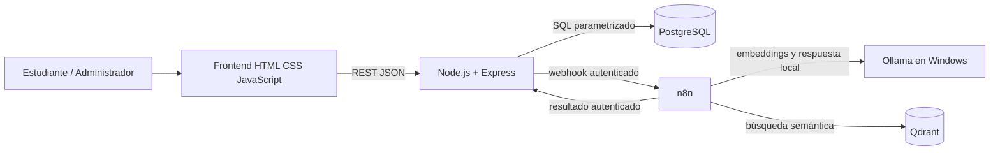

# Arquitectura lógica de RutaIA

## Límites

- El navegador consume exclusivamente Express; nunca conecta directamente a PostgreSQL, n8n, Qdrant u Ollama.
- PostgreSQL determina si cada curso existe y está activo antes de persistirlo como fuente.
- n8n envía el texto de cursos y las preguntas a Ollama local mediante `host.docker.internal:11434`; no se usan proveedores remotos de modelos ni una clave externa.
- El flujo debe guardar primero una consulta `Pendiente` y terminarla como `Respondida`, `Sin resultados` o `Error`.

Este diagrama describe la topología aprobada. Los servicios Docker y el acceso n8n→Ollama se comprobaron en local; una prueba aislada verificó embeddings, búsqueda y generación. Los workflows permanecen inactivos hasta configurar credenciales internas y calibrar el umbral; la ejecución n8n→callback aún no está verificada.
