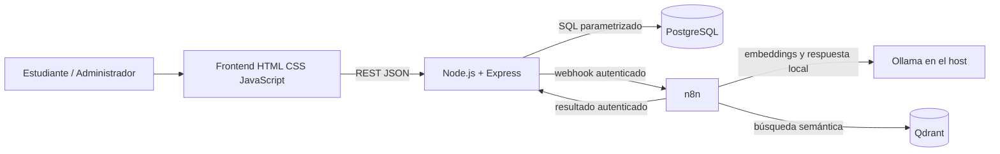

# Arquitectura lógica de RutaIA

## Límites

- El navegador consume exclusivamente Express; nunca conecta directamente a PostgreSQL, n8n, Qdrant u Ollama.
- PostgreSQL determina si cada curso existe y está activo antes de persistirlo como fuente.
- n8n envía el texto de cursos y las preguntas a Ollama local mediante `host.docker.internal:11434`; no se usan proveedores remotos de modelos ni una clave externa.
- El flujo debe guardar primero una consulta `Pendiente` y terminarla como `Respondida`, `Sin resultados` o `Error`.

Este diagrama describe la topología aprobada. Última verificación (4 nov 2026): los cuatro servicios Compose están saludables; PostgreSQL contiene 35 cursos activos y Qdrant tiene los mismos 35 UUID, sin faltantes ni huérfanos. El indexador terminó una ejecución CLI aislada y el workflow guardado permanece inactivo; el workflow de consulta está activo. Una E2E sintética anterior preguntó por formación en IA y terminó `Respondida` con tres fichas oficiales; el historial devolvió 200 y la calificación 201. Los datos sintéticos se limpiaron. La recalibración BGE-M3 (35 cursos, 22 casos) mantiene `.535`; IA y ciberseguridad general obtienen tres fuentes, mientras otras consultas medidas aún no llegan al mínimo o no tienen cobertura específica. La captura visual autenticada sigue pendiente: el control de escritorio detectó Chrome, pero se detuvo porque no pudo validar la URL actual con suficiente confianza.
