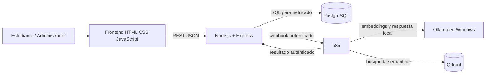

# Arquitectura lógica de RutaIA

## Límites

- El navegador consume exclusivamente Express; nunca conecta directamente a PostgreSQL, n8n, Qdrant u Ollama.
- PostgreSQL determina si cada curso existe y está activo antes de persistirlo como fuente.
- n8n envía el texto de cursos y las preguntas a Ollama local mediante `host.docker.internal:11434`; no se usan proveedores remotos de modelos ni una clave externa.
- El flujo debe guardar primero una consulta `Pendiente` y terminarla como `Respondida`, `Sin resultados` o `Error`.

Este diagrama describe la topología aprobada. En la última comprobación, Docker Compose mostró cuatro servicios saludables y n8n alcanzó Ollama. Tras los seeds 006/007, la API tiene 27 cursos activos y Qdrant 27 puntos. El workflow activo de consulta usa Ollama. La prueba E2E anterior con umbral `0.535` terminó en `Sin resultados` para cocina italiana y `Respondida` para gastronomía, con cuatro fuentes oficiales, historial y rating HTTP 201; los datos de prueba se limpiaron. La calibración corregida alinea los textos de embeddings con el workflow de indexación; ninguna de las siete preguntas académicas alcanza las tres fuentes requeridas (dashboards recupera dos). Una corrida anterior agotó 300 s, lo que muestra variabilidad en la inferencia local. Sigue pendiente la inspección visual autenticada: Work Settings todavía deshabilita el control del navegador local.
