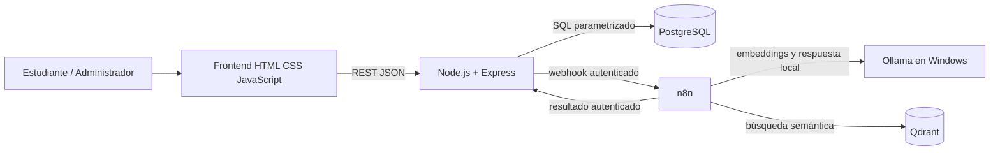

# Arquitectura lógica de RutaIA

## Límites

- El navegador consume exclusivamente Express; nunca conecta directamente a PostgreSQL, n8n, Qdrant u Ollama.
- PostgreSQL determina si cada curso existe y está activo antes de persistirlo como fuente.
- n8n envía el texto de cursos y las preguntas a Ollama local mediante `host.docker.internal:11434`; no se usan proveedores remotos de modelos ni una clave externa.
- El flujo debe guardar primero una consulta `Pendiente` y terminarla como `Respondida`, `Sin resultados` o `Error`.

Este diagrama describe la topología aprobada. Verificación actual: Docker Compose muestra los cuatro servicios saludables; PostgreSQL y Qdrant contienen los mismos 29 UUID activos. El workflow RAG está activo y el indexador permanece inactivo tras ejecutarse manualmente. La E2E por API registró e inició sesión, consultó el catálogo de 29 cursos y terminó `Respondida` en 65 s con las tres fuentes oficiales más relevantes; historial y calificación HTTP 201 funcionaron y los datos de prueba se limpiaron. Una consulta anterior de cocina italiana terminó `Sin resultados`. Tras observar un timeout real de 300 s con el límite anterior, el nodo Ollama ahora limita la generación a 192 tokens; la E2E volvió a pasar. La calibración actual todavía muestra que varias preguntas académicas obligatorias no tienen tres fuentes relevantes. La inspección visual autenticada sigue pendiente según la instrucción de trabajar por terminal.
