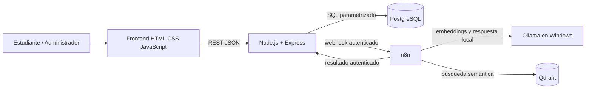

# Arquitectura lógica de RutaIA

## Límites

- El navegador consume exclusivamente Express; nunca conecta directamente a PostgreSQL, n8n, Qdrant u Ollama.
- PostgreSQL determina si cada curso existe y está activo antes de persistirlo como fuente.
- n8n envía el texto de cursos y las preguntas a Ollama local mediante `host.docker.internal:11434`; no se usan proveedores remotos de modelos ni una clave externa.
- El flujo debe guardar primero una consulta `Pendiente` y terminarla como `Respondida`, `Sin resultados` o `Error`.

Este diagrama describe la topología aprobada. Docker Compose muestra cuatro servicios saludables y se comprobó el acceso n8n→Ollama. La indexación real produjo 20 puntos. El workflow de consulta activo está sincronizado para Ollama; la prueba E2E positiva anterior persistió cinco fuentes, historial y rating 201. La consulta italiana con umbral `0.535` terminó `Sin resultados`. Una repetición positiva de gastronomía bajo el umbral final agotó el timeout de 300 s del nodo de chat; falta retestar esta rama y completar la inspección visual autenticada, bloqueada por Work Settings.
