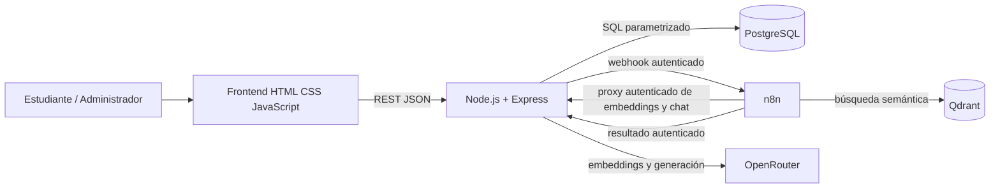

# Arquitectura lógica de RutaIA

## Límites

- El navegador consume exclusivamente Express; nunca conecta directamente a PostgreSQL, n8n, Qdrant u OpenRouter.
- PostgreSQL determina si cada curso existe y está activo antes de persistirlo como fuente.
- n8n envía el texto de cursos y las preguntas al backend mediante endpoints internos autenticados. Solo Express usa `OPENROUTER_API_KEY` para los modelos gratuitos configurados de embeddings y generación.
- El flujo debe guardar primero una consulta `Pendiente` y terminarla como `Respondida`, `Sin resultados` o `Error`.

El código y los workflows versionados usan proxies autenticados de Express para OpenRouter. Una solicitud sintética confirmó embeddings de 2048 dimensiones; la colección original `rutaia_courses` de 1024 dimensiones permanece intacta y la configuración nueva apunta a `rutaia_courses_openrouter_2048`. La calibración, reindexación y actualización de la instancia n8n local aún están pendientes. El umbral `.535` corresponde a BGE-M3 y debe recalibrarse antes de habilitar consultas.
