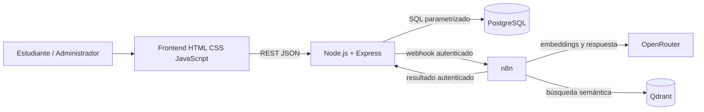

# Arquitectura lógica de RutaIA

## Límites

- El navegador consume exclusivamente Express; nunca conecta directamente a PostgreSQL, n8n, Qdrant u OpenRouter.
- PostgreSQL determina si cada curso existe y está activo antes de persistirlo como fuente.
- n8n y OpenRouter solo reciben el contexto mínimo necesario. Las credenciales permanecen en servicios backend.
- El flujo debe guardar primero una consulta `Pendiente` y terminarla como `Respondida`, `Sin resultados` o `Error`.

Este es el diseño objetivo, no evidencia de que las integraciones ya se ejecuten. En la inspección más reciente, PostgreSQL, Qdrant, n8n y Express estaban saludables en Docker; los workflows siguen inactivos y la operación RAG real se verificará por separado.
