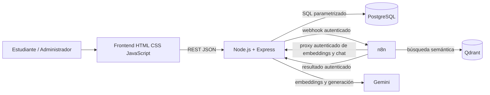

# Arquitectura lógica de RutaIA

## Límites

- El navegador consume exclusivamente Express; nunca conecta directamente a PostgreSQL, n8n, Qdrant o Gemini.
- PostgreSQL determina si cada curso existe y está activo antes de persistirlo como fuente.
- n8n envía el texto de cursos y las preguntas al backend mediante endpoints internos autenticados. Solo Express usa `GEMINI_API_KEY` para los modelos configurados de embeddings y generación.
- El flujo debe guardar primero una consulta `Pendiente` y terminarla como `Respondida`, `Sin resultados` o `Error`.

El código y los workflows versionados usan proxies autenticados de Express para Gemini. El backend exige `rutaia_courses_gemini_1536` y vectores de 1536 dimensiones; la colección original `rutaia_courses` de 1024 dimensiones no debe reemplazarse ni reutilizarse. Al 6 de noviembre de 2026, la calibración Gemini y la carga de los 37 cursos activos están verificadas; `RAG_MIN_SIMILARITY=0.642` es provisional. El responder Gemini está publicado y pasó una prueba E2E; el indexador sigue despublicado y hay dos eventos `delete` pendientes de sincronización.
